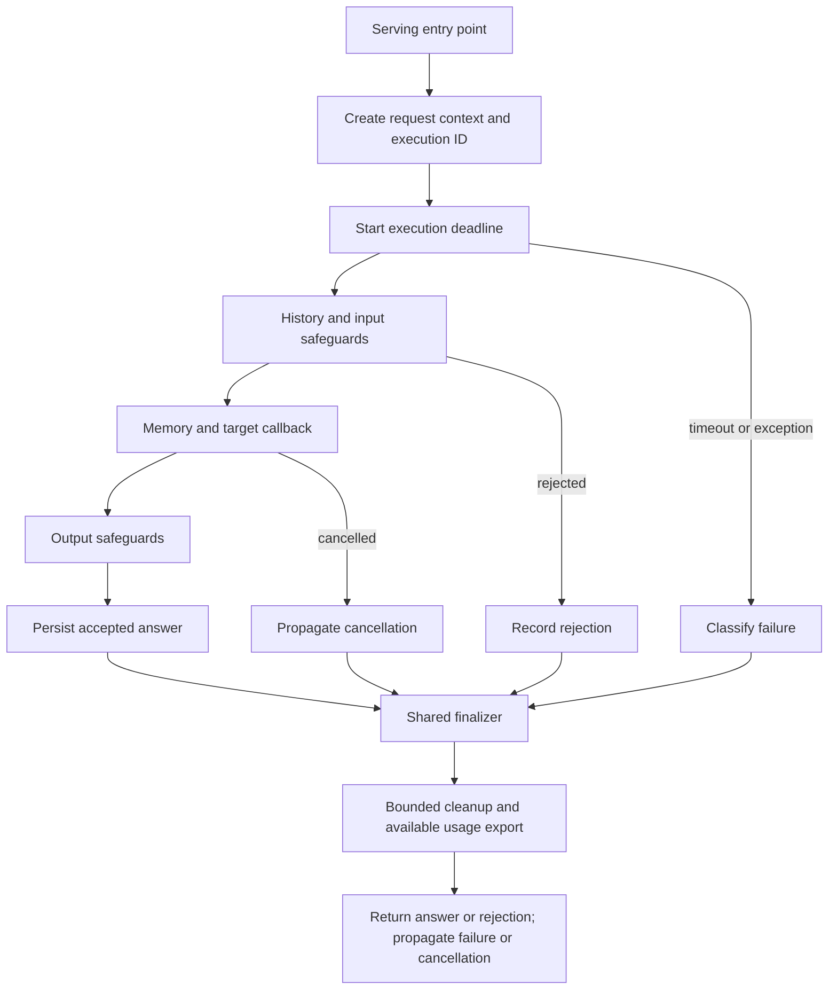

# AgentOPS error handling, deadlines, and cancellation

Status: broader implementation proposal. The initial centralized error hook, stage/outcome diagnostics, and best-effort finalizer are implemented; see [validation evidence](../development/error-lifecycle-validation.md). Remaining proposed features are not yet implemented. Existing behavior below describes the baseline reviewed before this change. Scope: shared serving middleware for single agents and supervisors; teams retain orchestration and tool recovery ownership.

## Design decision

AgentOPS owns the execution deadline, failure classification, request finalization, and safe failure metadata. The application owns transport timeouts and presentation. Targets own model/tool timeouts, idempotency, and domain-specific recovery. No framework retry of the entire target invocation.

Keep the synchronous MLflow `predict()` and `predict_stream()` entry points, with async middleware internals. Use one lifecycle and one finalizer for success, rejection, failure, and cancellation. Do not introduce another agent wrapper or clone targets.

## Current implementation and gaps

| Area | Existing implementation | Gap / proposed change |
|---|---|---|
| Request deadline | `RequestContext.scope()` wraps execution in `request_deadline()` using `asyncio.timeout()` | Deadline is optional. Add explicit outcome classification and configurable, bounded cleanup allowance. |
| Request ownership | Fresh `RequestContext`, `AsyncExitStack`, callback lifecycle | Add outcome, failure stage, elapsed time, release state, and usage completeness to per-request state. |
| Target invocation | `TargetAgentAdapter` calls one Responses or Chat Completions target path | Preserve typed failures and safe provider metadata; avoid collapsing every target failure into generic RuntimeError. |
| Streaming | Failure/incomplete events raise; buffered output supported; async generator closing uses `aclosing()` | Define and validate one client-compatible terminal failure policy; do not emit success after a failed stream. |
| Cancellation | Closing the sync iterator requests cancellation of the async producer | Client disconnect reaching the generator is transport-dependent; verify on serving. Cancellation cannot kill a running thread. |
| Blocking operations | SDK fallbacks run through `asyncio.to_thread()` | Cancellation stops waiting, not the operation. Set SDK-native timeouts; bound concurrent blocking work. |
| Observability | Normal successful path emits metrics and custom outputs | Exceptions and early guardrail returns bypass normal finalization. Move minimal outcome/available usage finalization into a shared finally path. |
| Persistence | Accepted answers saved after output checks | Separate response history from execution receipts. A persistence error after a completed target must not trigger inference again. |
| App | Example app catches transport/agent errors and uses a streaming read timeout | Align error schema and deadline budgets; distinguish unknown outcome from confirmed cancellation. |

Code anchors: `src/framework/agent_base.py`, `src/framework/inference/request_context.py`, `src/framework/inference/async_runtime.py`, `src/framework/inference/agent_middleware.py`, `src/framework/inference/cost_tracking_model.py`, and `examples/multi_agent_fe/app/server.py`.

## Request flow



The deadline covers preparation, target execution, checks, and required persistence. Finalization has a separate small bound. Gateway, serving, application, and network limits can end a request earlier; middleware cannot override them.

## Failure model

Introduce `ExecutionOutcome` and a small typed `AgentOPSError`, with categories: `invalid_request`, `guardrail_rejected`, `deadline_exceeded`, `dependency_timeout`, `dependency_unavailable`, `rate_limited`, `target_failed`, `invalid_target_response`, `persistence_failed`, and `internal_error`. Cancellation is a separate control-flow outcome, never converted into a generic exception.

Server-generated execution ID is authoritative. A caller-provided request ID is correlation metadata only, not identity, authorization, or a write-idempotency key.

Failure metadata:

```json
{
  "code": "deadline_exceeded",
  "message": "The request exceeded its execution limit.",
  "execution_id": "server-generated-id",
  "trace_id": "trace-id-if-available",
  "stage": "target",
  "retry_advice": "check_operation_status",
  "operation_outcome": "unknown",
  "partial_output_delivered": false,
  "usage_status": "partial"
}
```

Only include allowlisted metadata. Detailed stack traces stay in access-controlled logs/traces, subject to redaction. Never return secrets, raw provider bodies, prompts, or sensitive tool arguments in public errors. Do not infer that a write did not happen because a timeout occurred.

## Serving and streaming contracts

Prediction: preserve the original failure cause and mark execution failed. Prefer transport-level failure through the MLflow serving exception path. Do not invent custom HTTP status handling inside a ResponsesAgent. The serving platform controls exception-to-HTTP mapping; the App can map a documented, safely exposed error contract where supported.

Guardrail rejection remains a valid, configured Responses answer with rejection metadata. Operational failure must not masquerade as a successful assistant answer.

Streaming: buffered output prevents releasing an unchecked answer; public activity remains optional. Passthrough can leave partial content visible. On failure after headers are sent, the HTTP status cannot be changed. Use a validated Responses failure event only if the installed MLflow contract, Playground, Review App, and custom App all support it. Otherwise propagate the exception and let clients treat the interrupted stream as failed. This compatibility decision is a release gate, not an assumed capability.

At most one terminal outcome per request; never emit a success completion after failure. An abrupt process/transport termination may prevent any terminal event. Clients must detect missing completion and show interrupted/unknown status.

## Deadline and cancellation policy

Illustrative budget, to tune after latency measurements:

- Execution deadline: 120 seconds.
- Cleanup allowance: 3 seconds, separate from execution.
- Application total deadline: 150 seconds, if platform limits permit.
- Per-operation limits: target-owned and bounded by remaining request time where integration supports it.

A socket read timeout is an inactivity limit, not necessarily a total request deadline. Streaming activity can keep it alive. Configure connect, read-idle, and total deadlines independently.

Expose remaining time through RequestContext callbacks for context-aware integrations. Ordinary customer agents are not required to adopt a new base class. For them, enforce the outer deadline and document configuration of native client timeouts. Do not silently mutate shared SDK clients per request.

On cancellation: close async streams, request cancellation on the owner loop, close owned resources, perform bounded minimal finalization, then re-raise `CancelledError`. On generator close, preserve `GeneratorExit` semantics. Never broadly catch `BaseException` and return an answer. Remote cancellation requires an explicit supported API; otherwise record outcome as unknown.

Important runtime gap: `asyncio.run()` shuts down its default executor. A synchronous SDK call still running in that executor can delay loop shutdown beyond the logical deadline. The existing thread/queue bridges therefore do not prove a hard wall-clock deadline. Prefer native async clients with bounded network timeouts. If a strict bound is required for blocking dependencies, design a bounded, explicitly owned executor and admission control; threads still cannot be forcibly killed. Process isolation is a separate, heavier option for uncooperative work.

## Finalization and persistence

Use one idempotent finalizer for all outcomes. It records outcome, stage, latency, timeout/cancellation classification, emitted-output state, available usage, and cleanup status. It runs once per request and does not rerun inference or add synthetic model usage. Missing usage on interrupted requests is partial/unknown, never fabricated as zero.

Critical output checks fail closed. Optional telemetry failure must not replace the primary exception. Finalization exceptions are secondary diagnostics. Cleanup must have an explicit bound; `AsyncExitStack` alone does not provide one.

Accepted answer history excludes rejected/failed answer content. Execution receipts may record failure and completed side effects independently. Configure whether history persistence is required or best effort. If persistence fails after target completion, report the persistence issue without automatically replaying the target. No transaction spanning an arbitrary target and the history database is implied.

## Retry and side effects

Default: zero middleware retries of the agent callback. A supervisor may already have called several models or performed writes. Generic retries can repeat charges or side effects.

Dependency-specific bounded retries belong with the integration that understands the operation, error, and remaining budget. Honor provider retry hints only within that budget. Review SDK default retries, which may otherwise consume the entire deadline.

Write tools require team-owned idempotency keys, durable receipts, and status lookup. The framework execution ID can correlate them but does not by itself make operations idempotent. Retry advice must distinguish safe read retry, receipt lookup first, and unknown safety.

## Proposed code boundaries

| Component | Change |
|---|---|
| `inference/errors.py` (new) | Typed categories, allowlisted failure details, classification; no target orchestration. |
| `RequestContext` | Outcome/stage fields, remaining budget, finalization-once state. |
| `AgentOPSBase._callback_lifecycle()` | Deadline/failure/cancellation boundary and one shared finalizer around the existing lifecycle. |
| `AgentOPSBase._run_lifecycle()` | Stage updates and explicit rejection outcome; move shared metrics out of success-only branches. |
| `async_runtime.py` | Bounded cleanup, cancellation behavior, tests for blocking-worker and executor shutdown limits. |
| `TargetAgentAdapter` / Chat adapter | Preserve errors and validate target protocol; no automatic target retry. |
| `cost_tracking_model.py` | Keep serving bridges; consolidate usage export ownership with finalizer to avoid duplicate accounting. |
| Application client | Total/idle/connect deadlines, interruption detection, safe messages and trace links. App deployment remains separate. |

## Proposed configuration

```yaml
middleware:
  timeout_seconds: 120          # existing execution-deadline setting
  cleanup_timeout_seconds: 3   # proposed
  streaming:
    output_mode: buffered      # existing; passthrough is explicit opt-in
  persistence:
    history_failure_policy: best_effort  # proposed: best_effort or required
```

Validate finite positive timeout values at initialization. Keep error codes and cancellation semantics fixed in the shared framework rather than making every behavior configurable. There is no global `retry: true` setting.

## Validation and rollout

1. Local deterministic lifecycle tests: timeout during history, guardrail, target, output checks, and persistence; input rejection; provider errors; invalid target output; sync and async targets; cleanup failures; cancellation propagation; one finalizer and unchanged primary cause.
2. Streaming tests: buffered answer withheld on failure; passthrough marks partial delivery; target without streaming invoked once; cancellation closes owned generators; no successful completion on failure; slow/disconnected consumers; bounded queues.
3. Runtime tests in a subprocess with a wall-clock cap: demonstrate deadline versus blocking SDK completion and executor shutdown. Avoid hanging the test runner.
4. Accounting tests: available usage survives failure; partial usage stays partial; no duplicate model calls, retries, terminal outcomes, or token/cost exports.
5. FEVM validation through original AgentOPS pipelines for single and supervisor: normal calls, controlled slow target, provider failure, stream interruption, guardrail rejection, and history failure. Use synthetic side effects with receipts for any write scenario.
6. Verify actual wire behavior in Playground, Review App, and custom App; confirm timeout status, trace outcome, stream framing, cancellation latency, and no raw stack traces in public responses. Simulated unit schemas alone are insufficient.

Release gates: agreed external failure contract; measured end-to-end deadline behavior; one outcome/usage finalization; supported streaming failure behavior; no unintended target retries. Deploy behind a limited rollout and compare normal-request latency and failure rates before broad adoption.

## Decisions to agree before implementation

Recommended defaults: operational errors propagate as failures; guardrail rejections are safe Responses answers; buffered output remains default; history is best effort unless a team requires durability; no automatic inference retry; unknown remote operation outcome is explicit.

Open compatibility question: which structured failure details/events survive the currently deployed MLflow serving stack and its clients? Validate this first. Hard deadlines for blocking integrations and confirmed remote cancellation require integration-specific work and cannot be promised by middleware alone.
