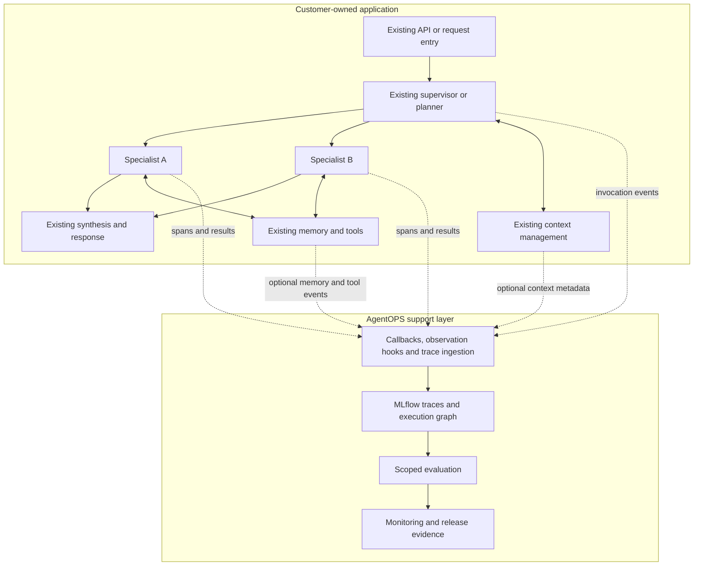
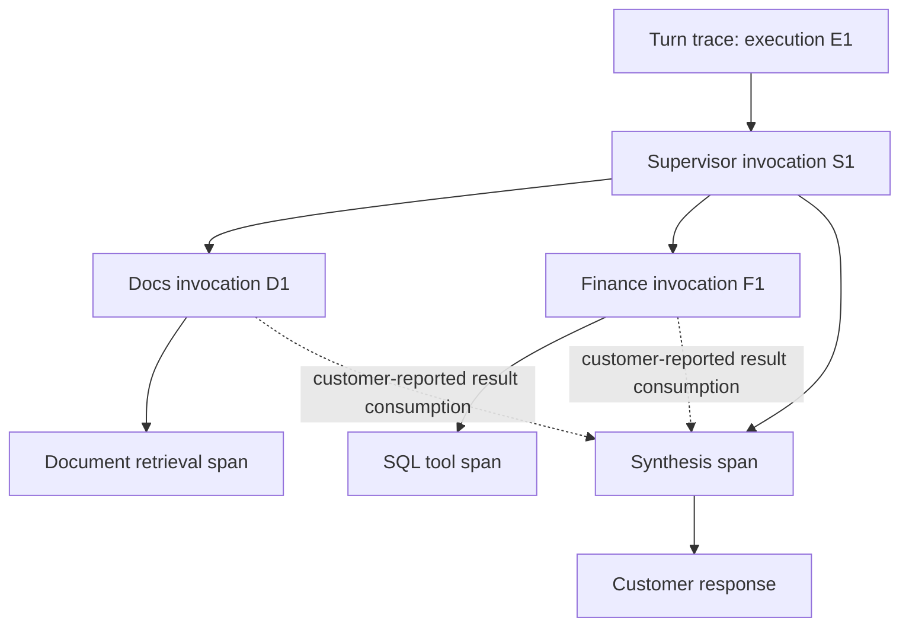
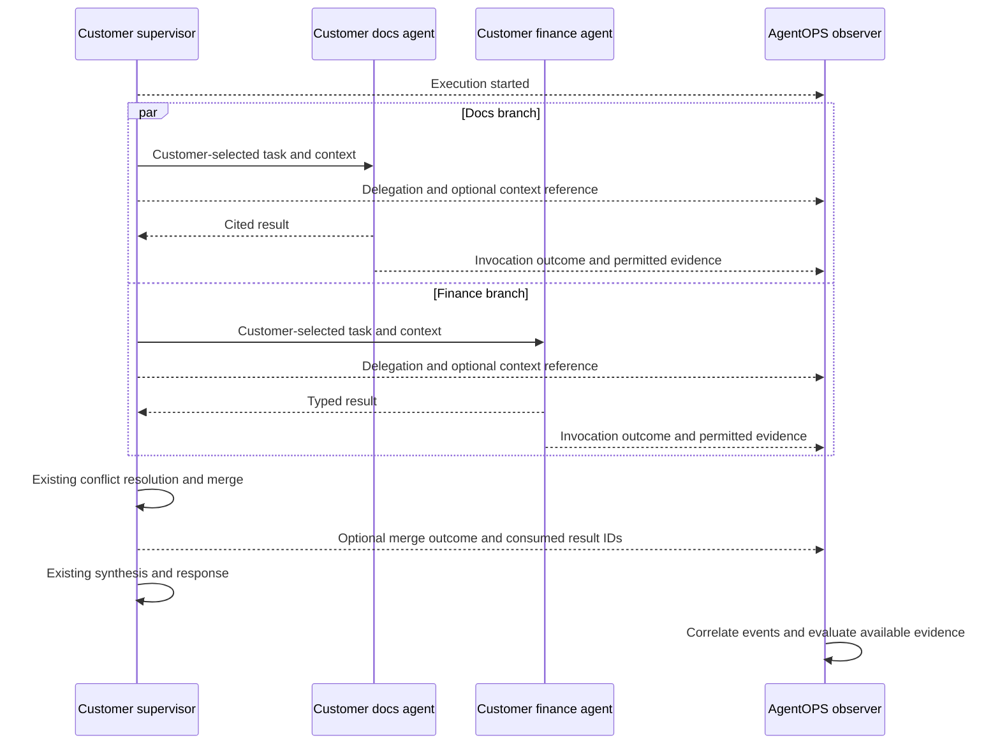
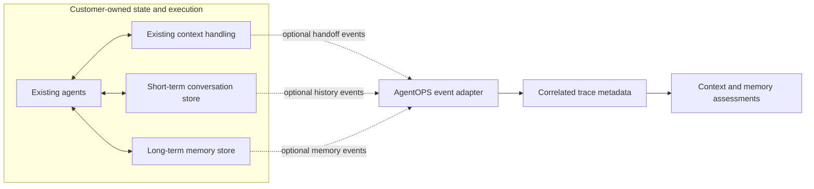
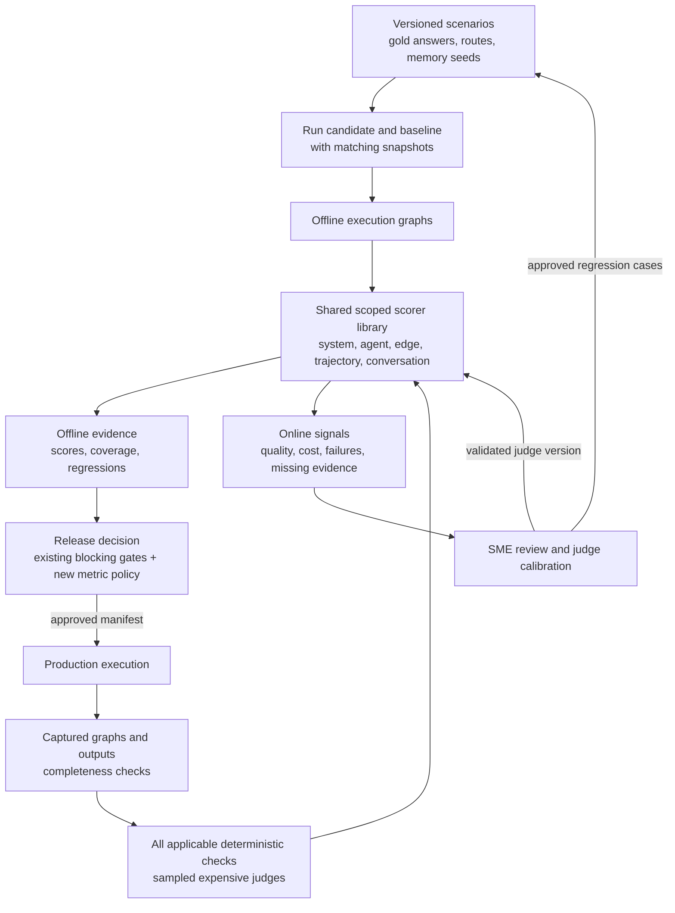

# AgentOPS Multi-Agent Support Architecture

Design options and recommended approach | November 2026

AgentOPS will support customer-built multi-agent systems through observability, evaluation, monitoring and explicitly configured guardrails. Customers retain their existing supervisors, planners, agent frameworks, context handling and memory stores. The integration adds operational visibility and quality evidence around those systems.

## 1. Recommendation and scope

Introduce a framework-neutral instrumentation contract and adapters for existing multi-agent runtimes. Extend the current MLflow tracing, domain scorers, LLM judges, production monitoring and release evaluation capabilities to understand agents, handoffs, execution paths and conversations.

The architecture has a clear ownership boundary: the customer application decides and executes; AgentOPS observes and evaluates. AgentOPS configuration describes what to instrument, capture and score. It does not define how the customer must orchestrate agents or maintain application state.

### Ownership boundary

| Responsibility | Customer application owns | AgentOPS provides |
|---|---|---|
| Orchestration | Supervisor/planner, agent selection, scheduling, delegation and termination | Agent/caller identity, call lineage, trajectory diagnostics |
| Context | Selection, summarization, sharing, authorization and result merging | Optional context events, version/reference correlation and context-quality evaluation |
| Memory | Backend, namespaces, access control, persistence, concurrency, TTL and deletion | Read/write telemetry, lifecycle evidence and memory-behavior evaluation |
| Tools and reliability | Tool execution, retries, deadlines, cancellation and side-effect safety | Attempt correlation, observed errors, latency, usage and budget diagnostics |
| Guardrails | Existing safety controls and decisions about additional enforcement | Existing AgentOPS checks at customer-selected boundaries, with explicit enablement |
| Serving | Application API, streaming behavior and deployment topology | Compatible instrumentation adapters and optional existing serving wrapper |
| Release | Approval process and application rollout/rollback | Versioned evaluation evidence and configured quality gates |

There is no AgentOPS context broker, planner, scheduler or application memory service in this proposal. Customers may retain existing AgentOPS single-agent wrappers and storage integrations; adopting multi-agent instrumentation does not require moving application logic or data into them.

### Required outcomes

- Identify the calling agent, receiving agent, invocation, attempt and contributing tool calls.
- Explain which available context and memory evidence influenced an answer.
- Evaluate final answers, individual agents, handoffs, trajectories and multi-turn behavior.
- Diagnose production quality, reliability, latency and cost by agent and interaction.
- Preserve application inputs, outputs, exceptions, routing, state operations and streaming behavior in observe-only mode.
- Report missing evidence explicitly rather than infer internal behavior from a final response.

## 2. Capability evolution

| Capability | Single-agent foundation | Multi-agent enhancement | Customer benefit |
|---|---|---|---|
| Integration | Request/response instrumentation | Runtime callbacks, invocation hooks and imported traces | Support existing agents with limited application changes |
| Tracing | Request, model and tool visibility | Agent lineage, branches, attempts and causal edges | Localize failures within a coordinated execution |
| Context visibility | Conversation and retrieval evidence | Optional handoff metadata, source references and versions | Diagnose context loss without replacing context management |
| Memory visibility | Session and user-memory integrations | Events from customer-owned short- and long-term stores | Evaluate continuity, stale-fact use and memory failures |
| Evaluation | Response quality and domain scoring | System, agent, edge, trajectory and conversation scopes | Find intermediate failures hidden by a plausible final answer |
| Monitoring | Latency, errors and quality trends | Per-agent/edge metrics, critical path and evidence coverage | Investigate regressions and operational bottlenecks |
| Guardrails | Configured pre/post checks | Optional integration points on selected agents or handoffs | Extend controls where requested without silently changing execution |
| Configuration | Single-agent settings | Instrumentation identities, capture mappings and scoped scorer bindings | Apply consistent operations across different runtimes |

## 3. Integration options and recommendation

These options differ in how telemetry is collected. Customer orchestration and state ownership remain the same in every option.

| Option | Approach | Advantages | Tradeoffs | Best fit |
|---|---|---|---|---|
| A. Native runtime callbacks | Attach adapters to existing framework callbacks or tracing hooks | Low integration effort; preserves native graph execution | Visibility depends on callback payloads and framework versions | Supported agent/graph frameworks |
| B. Explicit observation hooks | Add lightweight spans/events around selected existing calls | Precise agent, context and memory metadata; framework-neutral | Requires small, deliberate application changes | Custom Python systems or incomplete native callbacks |
| C. Trace ingestion and correlation | Read customer-exported MLflow/OpenTelemetry-compatible traces and events | Minimal application coupling; supports distributed deployments | Internal context/memory details may be absent; mapping and propagation need validation | Existing telemetry pipelines and remote services |

**Recommendation:** use native callbacks where available, explicit hooks to fill evidence gaps, and trace ingestion for independently deployed agents. Define one normalized observation model across all three. Start with the customer's first runtime; broaden adapter coverage after conformance testing.

### Evaluation operating model

| Stage | Purpose | Deliverable |
|---|---|---|
| Define | Agree metrics by business mode and agent role | Approved metrics, coverage and release criteria |
| Curate | Prepare representative scenarios and reviewed expectations | Versioned benchmark and customer-managed test fixtures |
| Measure | Score captured executions and components | Scores, rationales, diagnostics and evidence coverage |
| Calibrate | Confirm judge agreement with subject-matter experts | Validated judge versions and held-out results |
| Gate | Assess quality and regressions before promotion | Decision linked to a release manifest |
| Monitor | Track live quality, reliability, cost and feedback | Alerts and reviewed regression scenarios |

Existing release controls remain in force. New multi-agent quality metrics begin advisory until coverage and judge trust justify blocking thresholds. Production evaluation produces signals and does not change routing or memory. Additional inline AgentOPS enforcement requires explicit customer configuration.

## 4. Architecture and supported patterns

Solid arrows show customer execution; dotted arrows show observation. AgentOPS is outside the application's control and data flow.



| Customer pattern | AgentOPS observes | Evaluation emphasis |
|---|---|---|
| Supervisor/specialists | Delegation, caller/receiver and synthesis contributions | Routing, handoff completeness, synthesis |
| Sequential workflow | Existing stage order and outputs | Stage contracts, causal order, error propagation |
| Parallel fan-out/fan-in | Branches, overlap, result consumption and customer merge outcomes | Branch coverage, conflicts and critical path |
| Planner/executor | Customer-provided plan revisions and actual steps | Plan completion, replanning and observed budget use |
| Peer handoff | Transfer of control and context references | Context loss, unexpected transitions and loops |
| Debate/critic/reviewer | Rounds, critiques and final resolution | Disagreement handling and unsupported consensus |
| Distributed/asynchronous | Service/task correlation, attempts and resumption events | Trace completeness, retries and long-running execution |

Supporting a pattern means observing and evaluating the customer's implementation. It does not mean supplying the runtime for that pattern.

### Proposed observation contracts

- `ExecutionMetadata`: system/version, execution/request IDs, environment, optional mode/thread/turn references and customer release manifest.
- `InvocationMetadata`: agent/version, invocation ID, caller invocation ID, task ID, attempt and branch ID when supplied by the runtime.
- `AgentObservationAdapter`: observes existing invocation start/end/error callbacks while preserving the application's return values and exceptions.
- `ContextEvent`: customer-supplied context/reference ID, source/target invocation, optional revision, fields, summary metadata and evidence references.
- `MemoryEvent`: observed read/write/delete, customer-defined scope, optional record/revision, outcome, latency and provenance references.
- `TraceGraphBuilder`: correlates spans and explicit events into a causal graph, reporting missing information.
- `ScopedScorer` and `ReleaseGatePolicy`: select evidence, determine applicability, produce assessments and evaluate configured promotion criteria.

Observation contracts describe telemetry. They do not require customer agents to adopt a new result object, state schema, invocation API or memory backend.

### Integration example

The following is an illustrative proposed API. Existing application code builds the context and calls the agent. The observation scope only records the invocation.

```python
context = customer_context_builder(task, specialist)

with agentops.observe_agent(
    agent_id="finance",
    caller_agent_id="supervisor",
    context_metadata={"version": context.version},
):
    result = specialist.invoke(task, context)
```

A native callback adapter can produce equivalent telemetry without adding this scope around every call. Customers choose the integration depth. External services can export correlated spans instead.

### Observe-only behavior and optional guardrails

New multi-agent adapters default to observe-only operation. They do not rerun calls, retry tools, buffer streams, rewrite arguments, change outputs or commit application state. Telemetry export failures follow a documented fail-open policy with health reporting; explicitly mandatory audit requirements can use a separately approved fail-closed policy.

Existing enabled AgentOPS guardrails retain their configured behavior. Additional agent/handoff checks are opt-in and declare boundary, input/output mapping, observe versus enforce mode, failure action and latency expectations. Streaming enforcement or buffering is an explicit application integration decision, never an instrumentation default.

## 5. Granular tracing and causal graph

Use one trace per synchronous turn where supported, with a stable execution ID across all participating agents. Link conversation turns using customer-provided thread/turn references. Reuse existing native spans where possible; avoid creating duplicate model/tool spans around autologged calls.

For remote calls, preserve existing propagation and add supported W3C context only through approved integration. Where parenting is unavailable, retain separate traces linked by execution, task and delegation IDs. An explicit data-dependency edge records which agent result was consumed by synthesis.



Solid arrows represent call ownership; dotted arrows represent observed data dependencies. Caller relationships alone do not prove that a result influenced the final answer.

| Observation | Core fields | Optional deeper evidence |
|---|---|---|
| Execution | System/version, execution ID, environment, status and time | Release manifest, mode and pseudonymous thread/turn |
| Invocation | Agent ID, invocation ID, caller or external parent, status and duration | Agent version, branch, task and attempt |
| Handoff/context | Source/target invocation and event/reference ID | Revision, field names, evidence IDs, summaries and token counts |
| Memory operation | Owning invocation, operation, outcome and latency | Scope, record version, expiry, provenance and customer policy decision |
| Tool/LLM | Owning invocation, operation/model and duration | Reported tokens, cached/reasoning usage, price version and error class |

Store custom attributes under `agentops.*`. Map trusted application identity metadata to pseudonymous references; AgentOPS does not replace application authentication. Required fields apply to the selected integration profile. Unavailable optional metadata reduces the corresponding evaluation coverage.

Capture policy applies before exporting span inputs, outputs, exceptions and tool payloads. Default to metadata and approved references; content capture requires authorization. Keep private scratchpads excluded. Customer context and memory are not copied wholesale into AgentOPS. Evaluation requiring semantic content uses customer-approved redacted evidence or authorized reference resolution.

Use task-local instrumentation state with deliberate propagation and cleanup for async tasks and threads. Observation of one execution must not contaminate another. Preserve customer cancellation and exception behavior.

Completeness checks identify orphaned invocations, missing terminal states, unlinked handoffs and incomplete branches where expected counts are supplied. Without authoritative branch expectations, structural connectivity alone cannot prove completeness. Missing evidence produces `insufficient_evidence` for dependent scorers.

Aggregate cost at unique billable LLM leaves, including retries when usage is reported. Keep serving and judge costs separate. Avoid summing parent rollups and child usage. System latency is wall time; parallel diagnosis uses the observed critical path. Unknown usage and price remain unknown.

## 6. Observing context and memory

### Context remains application-owned

The customer supervisor/planner selects the next specialist and prepares its context using existing application logic. AgentOPS records available handoff metadata and evaluates whether the observed information supports the task. It does not select fields, summarize content, authorize access or merge branch results.

Customers can expose context IDs, revisions, source references, included/omitted fields and summarization metadata through callbacks or explicit events. Existing customer version identifiers are used unchanged; adopting instrumentation does not require versioned snapshots. If versions are unavailable, AgentOPS reports that provenance limitation.

### Parallel execution example

The customer runtime performs all context preparation, delegation and result merging. AgentOPS receives observation events alongside those operations.



Potential diagnostics include required facts lost across a handoff, evidence omitted from a summary, stale context, contradictory specialist results, and unsupported synthesis. Findings are assessments; the application remains responsible for corrective actions.

### Short-term versus long-term memory visibility

| Customer state | Meaning | Useful optional events | AgentOPS evaluation |
|---|---|---|---|
| Invocation scratch | Temporary agent-local work | Existence/lifecycle metadata only | Isolation evidence where available; no private reasoning capture |
| Shared working context | Information exchanged during one execution | Handoff and merge references | Context continuity and result contribution |
| Short-term conversation | History within a customer thread/session | History load, summary, save, outcome and revision | Follow-up resolution and relevant-history retention |
| Long-term memory | Approved facts retained across sessions | Recall, write, correction, expiry and deletion outcomes | Relevant recall, stale-fact use and correction behavior |
| Domain knowledge | Governed customer documents/data | Retrieval and source-version references | Retrieval relevance, correctness and grounding |
| Durable checkpoint | State used to resume customer workflows | Checkpoint/resume and completed task references | Resume equivalence and duplicate-effect diagnostics |



Customer stores retain ownership of namespaces, permissions, transactions, TTL, deletion and concurrency semantics. AgentOPS can assess policy outcomes exposed by those stores; it cannot establish tenant isolation or durable deletion from an invocation span alone. Evaluation fixtures exercise those behaviors through customer-provided test hooks.

An event must distinguish a successful empty read from an unavailable backend or denied read when the customer exposes that distinction. AgentOPS records the application's fallback outcome without introducing a new fallback path.

## 7. Evaluation model

Evaluate five units: final system answer, individual agent invocation, inter-agent edge, complete execution trajectory, and multi-turn conversation. Reuse scorer implementations across offline and online evaluation where evidence requirements are satisfied. Preserve existing builtin, LLM-judge and domain categories; scope is an additional axis, not a replacement category.

| Scope / metric | Mechanism and evidence | Offline | Production |
|---|---|---|---|
| System correctness | Reference judge or typed result comparison | Gold answer/value | Only on reviewed labeled traffic |
| System relevance, critique quality, groundedness | Mode-specific judge plus actual evidence | All applicable cases | Sampled, evidence-dependent |
| Agent/domain correctness | Existing domain scorer over selected agent output and relevant local input/evidence | Expected facts/value or rubric | Reference-free subset only |
| Routing accuracy | Actual delegation set versus allowed/required/prohibited routes | Scenario expectations | Reviewed cases; otherwise route distribution and policy checks |
| Retrieval Recall@k | Unique expected source-document IDs retrieved / expected IDs | Expected documents required | Labeled cases only; online retrieval health otherwise |
| Handoff schema and policy compliance | Deterministic input/output schemas and field authorization | All instrumented boundaries | All instrumented boundaries |
| Handoff factual retention | Required facts preserved / required facts, with citations | Labeled facts and summaries | Sampled judge when source and projection exist |
| Trajectory validity | Required partial-order constraints, prohibited edges, max attempts/rounds | All scenarios | Observed policy outcomes without gold route claims |
| Coordination quality | Redundant delegations, unresolved conflicts, synthesis coverage | Graph plus rubric | Sampled complete graphs |
| Memory read/write correctness | Expected facts, namespaces, revisions, read-after-write and correction/deletion behavior | Seeded multi-turn fixtures | Policy checks and reviewed samples; no assumed gold |
| Safety/isolation | Boundary checks, tenant access invariants, adversarial scenarios | All relevant scenarios | Observed customer policy outcomes; optional configured guardrails |
| Reliability/cost/latency | Deadlines, branch failures, leaf usage, critical path | Load and fault scenarios | All observable executions, with coverage reported |
| Consistency | Repeated scenario runs and outcome variance | Repeat selected critical cases | Controlled reviewed replay; avoid side effects |

Trajectory scoring permits multiple correct solutions. Represent required nodes, allowed alternatives, prohibited operations, partial-order constraints and bounded retries. Exact sequence matching is suitable only for deterministic workflows. A high-quality final answer cannot compensate for a policy violation or unauthorized memory access.

### Scorer contract and aggregation

A scorer declares ID/version, category, mechanism, scope, selectors, required evidence, applicable modes, expectation keys, native score type/range, normalization, aggregation and cost policy. Select by stable attributes and parent/causal relationships. Evaluate each matching invocation; group by agent and edge. Remote incomplete traces must be stitched before scoring or marked incomplete.

Store `value` separately from status: `scored`, `not_applicable`, `insufficient_evidence`, `error`, `not_sampled`. For example, a factual correctness metric is not applicable to a strategic critique with no gold answer; a missing required docs span is insufficient evidence, not non-applicability. Do not average a string `skip`, count it as zero, or treat it as success. MLflow feedback mapping is version-dependent; the AgentOPS result envelope retains these statuses even when the SDK cannot represent them directly.

For numeric comparison, retain native values and explicit transforms: 1–5 rubric → `(x-1)/4`, booleans → 0/1. Use metric-specific direction and units for latency/cost. Report applicable count, scored count, errors, missing evidence and coverage beside every aggregate. Coverage = scored / applicable scheduled units; sampling rate is reported separately. Required coverage and minimum per-agent/per-mode counts are release-gate inputs, when configured by the customer.

Do not average different score scales or let high-volume easy-agent scores hide a specialist regression. Report per-agent/edge/mode slices and macro summaries. Maintain separate system quality, process correctness, safety and operations gate groups; weighted quality summaries are advisory and cannot override hard failures.

### Offline and preproduction

Run a scenario once per candidate/repetition and score the resulting trace with all applicable scorers. Multiple scorer groups must not independently rerun the agent. Reuse `mlflow.genai.evaluate()` with nested `inputs` and a prediction function receiving unpacked keyword arguments; retain the complete execution trace for each scenario. Component evaluators select the appropriate subgraph rather than passing an unrelated root answer to every scorer.

Introduce scenario schema v2 alongside the legacy golden schema. Required scenario fields: ID, schema version, mode, input turns, memory seed, expectation map, coverage labels and data snapshot references. Customer-provided setup/teardown hooks prepare isolated test state and clean it afterward. AgentOPS invokes only hooks explicitly configured for evaluation; it does not create or migrate application memory stores. Never pass gold expectations into agent-visible context. Scenario templates cover routing, multi-agent synthesis, cross-session memory correction and rubric-based critique.

Coverage must include single specialist, multiple specialists, unsupported route, refusal, conflicting evidence, context truncation, follow-up/pronouns, long-term recall across sessions, stale-memory correction, tenant isolation, branch timeout, retry, cancellation, duplicate delivery and streaming interruption. Unit-level contract checks complement end-to-end scenarios. Repeated critical scenarios measure nondeterminism. Fault tests must use safe tool doubles or isolated sandboxes.

Pin candidate and baseline to the same dataset snapshot, tool/corpus snapshot and memory seed. Record code commit, wheel/model versions, config digest, prompt versions, agent topology, tool versions, judge and rubric versions, endpoint model revision when available, and SDK/runtime versions in a release manifest. Live data/model changes limit replay fidelity and must be declared.

### Judge calibration and release decisions

Use SME-reviewed labels stratified by mode, agent and failure class. Measure pass/fail agreement plus false acceptance/rejection and uncertainty; retain native rubric labels as well. Align judges using the existing MemAlign flow where supported, then validate on held-out labels. Pin aligned judge versions per evaluation. Do not tune prompts or judges on the held-out release set. Agent application memory and judge alignment memory are different stores and purposes.

Preserve current blocking quality/guardrail gates. New multi-agent quality metrics begin advisory until data, coverage and judge trust justify enforcement. Customer-approved release criteria for contract, isolation and execution-budget test outcomes may block promotion immediately. These release gates do not introduce runtime scheduling or state enforcement. A gate record lists absolute thresholds, paired baseline regressions, coverage, failed slices, exceptions, approver and exact release manifest. Missing mandatory scores means incomplete evidence. Rollback promotes a known manifest; consider memory schema compatibility and state migration separately from model traffic rollback.

### Production

Use complete execution graphs for component scoring. Existing inference payload monitoring remains useful for final-answer metrics, but cannot prove internal routing, context or memory correctness. Join payloads to server trace IDs through an explicit mapping. Where internal traces are absent, record unavailable component coverage and alert on instrumentation loss.

Evaluate deterministic invariants over available events. Customer runtime controls continue to enforce application policy. AgentOPS inline guardrails run only at explicitly configured integration points; observe-only integration is the default for new multi-agent adapters. Sample expensive judges by mechanism, with stable execution-ID selection and stratification for rare agents/modes. Retain full graphs for sampled executions rather than independently sampling away their children. Oversample failures for diagnosis, but keep that cohort separate from an unbiased trend cohort. Under budget pressure, record deferred/not-sampled work and coverage; never silently disable explicitly enabled inline guardrails.

Online scoring must assess captured output/evidence without invoking the application or tools again. Use idempotent result keys `(execution, scope instance, scorer version, evidence revision)`, ingestion watermarks, late-span retry, bounded retries and dead-letter reporting. Keep monitor/judge traces distinct from application traces to prevent recursive monitoring and cost contamination.

### Two evaluation paths, one improvement loop

Offline evaluation produces release evidence from controlled scenarios. Online evaluation scores captured production evidence and raises operational signals. Reviewed production findings become new scenarios for later releases.



The scorer library records the evaluation plane with every result: offline evidence feeds release decisions, and online signals feed monitoring. Both paths report missing evidence explicitly; neither treats an unavailable component trace as a passing score.

Dashboards drill down system → mode → agent → edge → invocation → context/memory event. Show latency percentiles, critical path, error/retry/timeout rates, branch completion, context loss, memory conflicts, leaf serving cost, judge cost, trace completeness and score coverage. Alert on missing evidence as well as quality drift. User thumbs are feedback signals, not correctness labels. Reviewed failures and useful successes become versioned scenarios; agreement drift triggers recalibration.

## 8. Configuration v2

The new configuration describes AgentOPS integration and evaluation. Customer application configuration remains authoritative for models, prompts, routing, context, memory, tools and scheduling. AgentOPS may record customer-supplied version references for release comparison without managing those components.

| Section | Responsibility | Example settings |
|---|---|---|
| `system` | Observed application identity | System ID/version, environment and customer manifest reference |
| `integration` | How existing telemetry is connected | Native callback, explicit hook, or trace ingestion; observe-only mode |
| `agents` | Observed agent identities and selectors | Stable agent ID, role, span/callback mapping |
| `context_observation` | Optional context event mapping | Customer context ID/version paths, approved evidence references |
| `memory_observation` | Optional memory event mapping | Read/write event names, scope/outcome paths; no backend credentials |
| `capture` | Telemetry disclosure controls | Redaction, metadata-only defaults, authorized evidence access |
| `guardrails` | Explicitly configured existing checks | Selected boundary, check, observe/enforce mode and failure behavior |
| `tracing` | AgentOPS telemetry management | Destination, propagation integration, retention and health reporting |
| `evaluation` | Scoring and release evidence | Scoped scorers, expectation keys, coverage, sampling and gates |

The companion configuration example uses this observation-oriented structure. It does not declare callable entry points, allowed runtime edges, context reducers, memory backends, retries or execution limits. Expected routes and budget thresholds can appear as evaluation expectations; they do not control production execution.

Resolve AgentOPS settings as framework defaults → team/system settings → environment overlay → explicit allowlisted overrides. Preserve explicit `false`, `0` and empty lists. Validate observation mappings, agent IDs, scorer references, capture permissions and score scales; do not reject a customer's runtime graph because it differs from an expected evaluation path.

Legacy single-agent configuration follows its existing behavior. The new multi-agent integration is additive: no application memory migration, prompt rewrite, runtime replacement or public response-shape change is required. Customer IDs can be mapped to telemetry aliases without modifying application state.

## 9. Telemetry persistence and integration depth

MLflow remains the trace and assessment integration layer. Governed AgentOPS reporting tables store execution metadata and evaluation evidence rather than application working state.

| Logical dataset | Grain | Content |
|---|---|---|
| `system_executions` | Execution ID | Customer manifest reference, status, trace IDs and evidence coverage |
| `agent_invocations` | Invocation + attempt | Agent/caller identity, trace/span, branch, outcome and usage |
| `execution_edges` | Observed edge ID | Delegation, handoff and result-consumption references |
| `context_events` / `memory_events` | Event ID | Customer-supplied versions/outcomes and restricted evidence references |
| `scoped_scores` | Execution + scope + scorer version + evidence revision | Value, status, rationale, coverage and sampling cohort |
| `evaluation_manifests` / `gate_decisions` | Evaluation run / decision | Benchmark snapshots, thresholds, baseline and approval |

Use idempotent telemetry ingestion, late-event watermarks and trace deduplication. Telemetry retry must never retry an application invocation. AgentOPS retention/deletion policies apply to its own captured copies and indexes; customer application data lifecycle remains separate.

### Progressive visibility

| Integration depth | Available evidence | Supported conclusions |
|---|---|---|
| Endpoint only | Request, final response, latency and status | Final-answer quality and endpoint reliability |
| Agent spans | Invocation/caller/attempt and tool/model spans | Per-agent performance and observed execution paths |
| Context and memory events | Handoff references, state operations and outcomes | Context continuity and memory diagnostics, where evidence is sufficient |
| Approved semantic evidence and fixtures | Redacted content, labeled expectations and isolated test hooks | Detailed component correctness and multi-turn behavior |

Customers can begin at any depth. Metrics that need unavailable evidence remain unavailable; AgentOPS does not require redesigning the application to produce a misleading completeness claim.

Validate adapter/framework and MLflow versions, async propagation, remote correlation, trace persistence, private networking and approved judge access. Experiment-managed storage or UC trace storage/export can be selected according to retention and governance needs. Optional native monitoring and scheduled trace-based evaluation share the same observation model.

## 10. Delivery roadmap and acceptance

| Phase | AgentOPS delivery | Acceptance evidence |
|---|---|---|
| 0: Integration foundation | Observation schema, configuration, first runtime adapter and persistence canary | Existing application operates unchanged; a correlated multi-agent trace can be retrieved |
| 1: Invocation visibility | Caller/agent identity, branches, attempts, async propagation and graph builder | No duplicate calls/spans; original results, errors, cancellation and streams preserved |
| 2: Context and memory visibility | Optional customer event mappings and restricted evidence integration | Existing stores unchanged; missing versions/content reported; captured metadata obeys disclosure policy |
| 3: Scoped evaluation | Scenario runner, agent/edge/trajectory/conversation scorers and release evidence | One execution per scenario; held-out evaluation and evidence coverage; no production replay |
| 4: Production operations | Trace-based scoring, per-agent dashboards, cost attribution and instrumentation health | Idempotent scoring, late-event handling and separate serving/judge cost |
| 5: Adapter expansion | Additional customer runtimes, remote services and durable workflow telemetry | Cross-service correlation and resume/attempt diagnostics without owning workflow execution |

### Acceptance criteria

1. Observe-only integration preserves application inputs, outputs, exceptions, agent selection, call counts and memory operations.
2. Sync, async, concurrent and streaming behavior is preserved, with measured instrumentation overhead within an agreed latency budget.
3. No customer memory store, namespace, context schema or orchestration topology must be migrated.
4. Application retries, timeouts, cancellation and side effects remain customer-controlled; telemetry failure cannot trigger an application retry.
5. Caller/receiver, attempts and result contributions are reconstructed where corresponding evidence exists; unsupported conclusions are marked unavailable.
6. Cross-execution instrumentation state and captured evidence remain isolated, with capture policy applied before export.
7. Final-answer, agent, handoff, trajectory and conversation assessments retain applicability and evidence status.
8. Online scoring never re-executes customer tools or agents. Offline setup/teardown uses only explicitly configured test hooks.
9. Additional inline guardrails are enabled only through explicit boundary configuration; existing configured single-agent controls remain compatible.
10. Release records identify the customer application version, AgentOPS configuration, benchmark, scorers and judge versions used.

## 11. Decisions and operational considerations

Confirm the first customer runtime and supported callback APIs, existing trace destinations, stable agent/caller identifiers, approved content-capture level, customer event availability, judge endpoints/region, telemetry retention and required release criteria. Agree an adapter overhead budget and telemetry outage policy before production rollout.

The main risks are incomplete internal telemetry, callback incompatibilities, duplicate spans, exposure of sensitive evidence, inaccurate caller mapping and instrumentation that changes exception or streaming behavior. Adapter conformance and capture-policy tests address these risks before enabling additional evaluation scopes.

The recommended default is observe-only multi-agent integration, metadata-first capture, explicit evidence coverage, advisory new quality metrics and customer-controlled application behavior. The resulting architecture supports existing agents while making their collaboration measurable and diagnosable.
