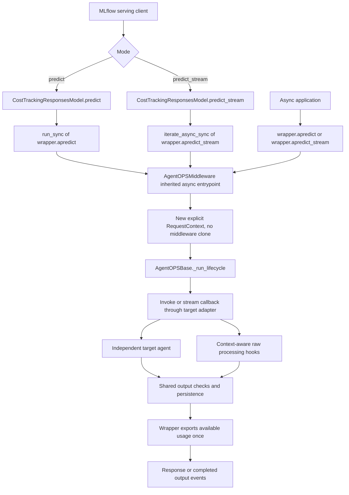
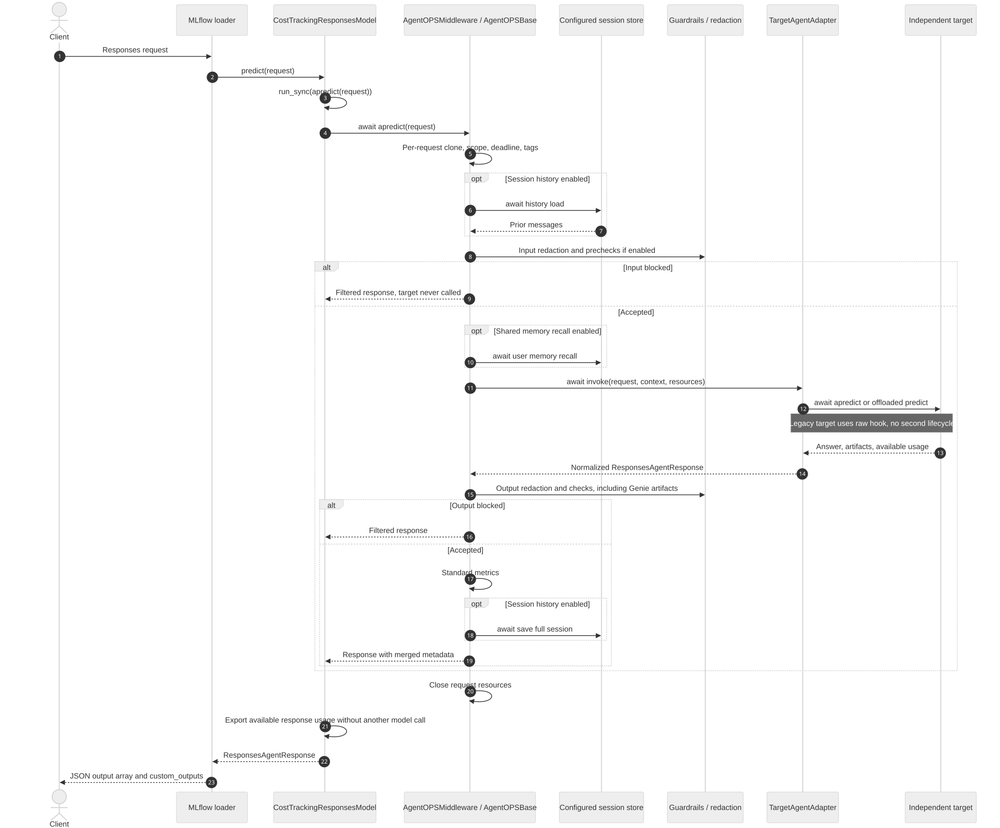
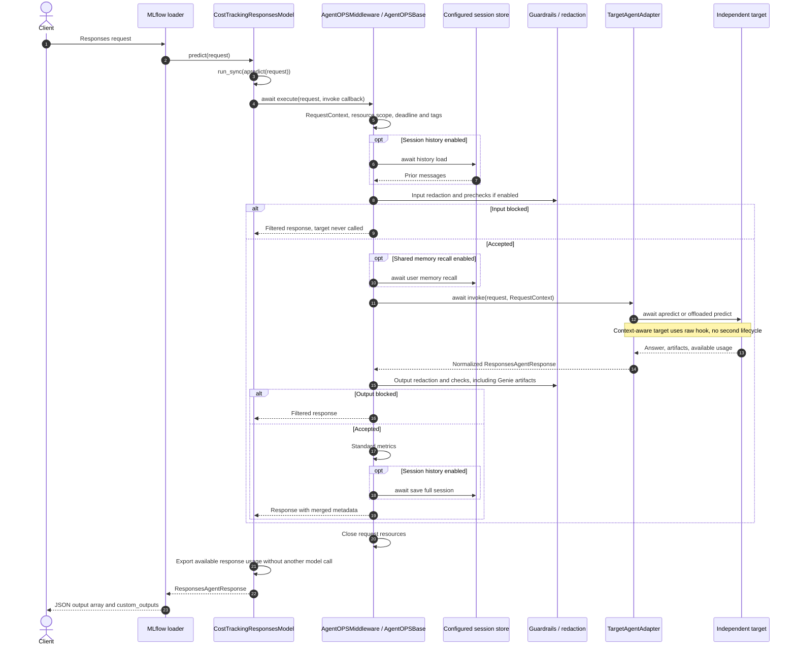
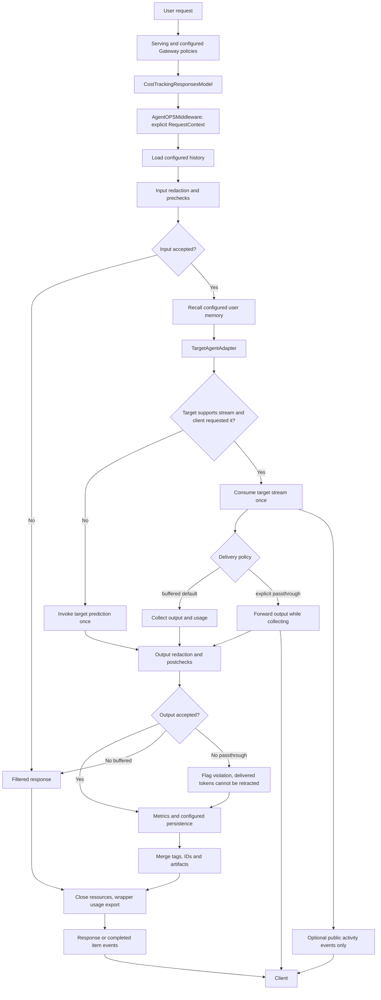
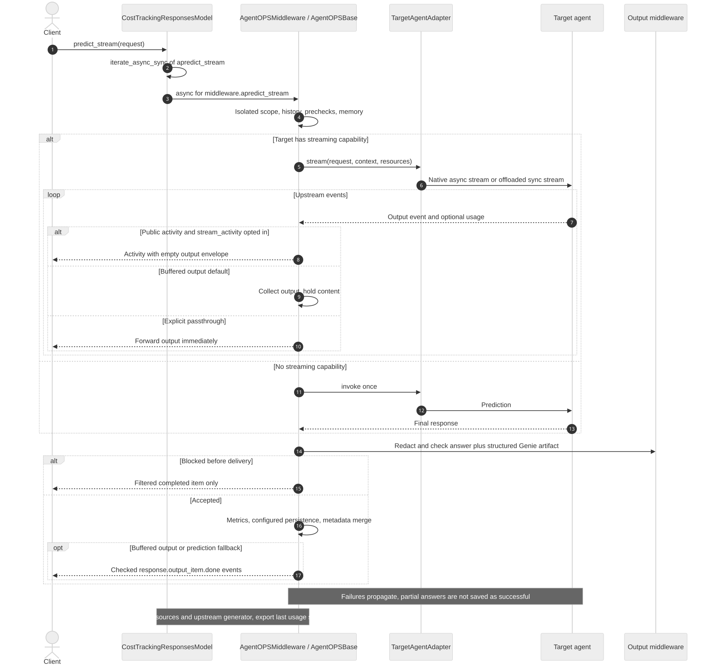
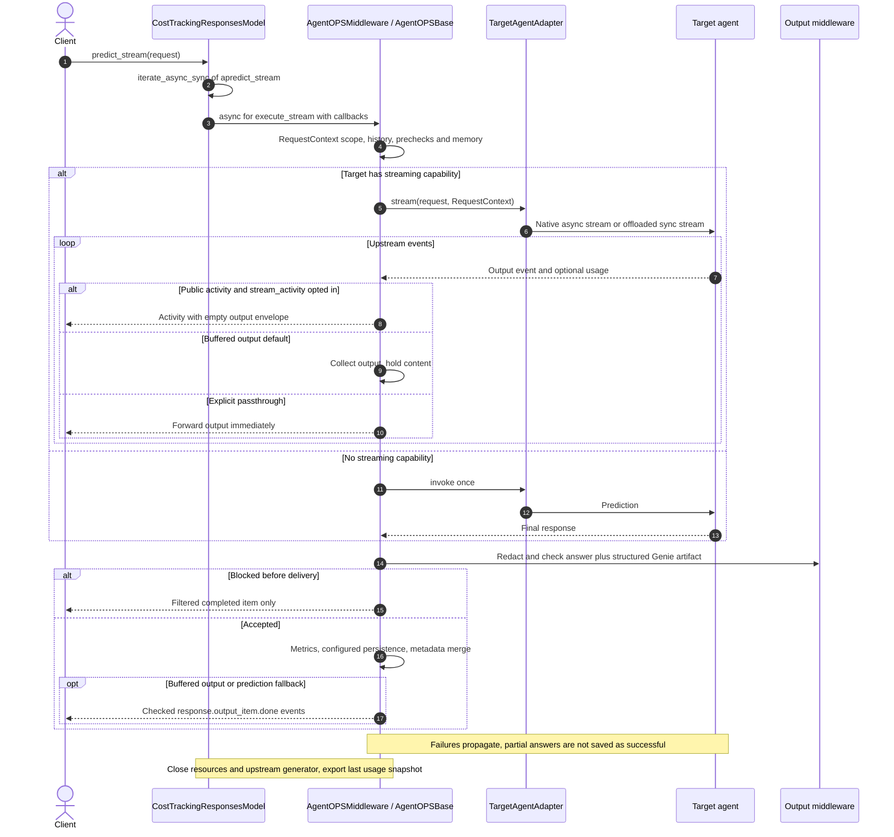
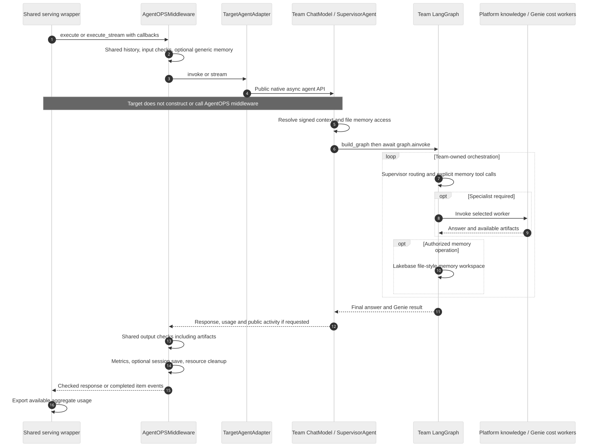

# AgentOPS request lifecycle and function dependencies

AgentOPS owns the outer request lifecycle and calls the configured target agent.
The target owns orchestration, tools and models. It does not create middleware.

## Serving contract

`MLflow loader → CostTrackingResponsesModel → AgentOPSMiddleware.execute / execute_stream → invocation callback → target`

The same lifecycle serves single agents and supervisors. `AgentOPSMiddleware`
reuses `AgentOPSBase._run_lifecycle`; it does not copy its logic. Plain
ResponsesAgents use their public APIs. PythonModels receive the normalized request
through `predict(context=None, model_input=...)`. Context-aware AgentOPSBase targets use
raw processing hooks, bypassing their public lifecycle to avoid duplicate checks.

[Open the diagram viewer with zoom controls](agentops-diagrams.html).

## Reading the diagrams

`await` can use a native async integration or offload an existing blocking call.
An async caller is an application using `await wrapper.apredict(request)` or
`async for event in wrapper.apredict_stream(request)`. It is not a second agent.
MLflow serving still uses synchronous `predict` and `predict_stream`; the bridge
adapts those interfaces to the same async lifecycle without replaying inference.

## Public prediction and streaming entry points





## Request sequence





## Request flowchart





## Streaming sequence





## Supervisor integration




## Configuration and delivery

```yaml
middleware:
  timeout_seconds: 120
  streaming:
    output_mode: buffered
```

The timeout is optional and includes checks, target work and persistence. Output
is buffered by default until postchecks finish. `passthrough` explicitly opts into
immediate output delivery; later violations can be flagged but cannot retract
content. Output PII redaction forces buffering. Buffered streaming emits completed
items after checks, rather than token deltas. Targets can emit public activity
when the request opts into `custom_inputs.stream_activity: true`; this is progress
metadata, not private model reasoning. Playground requests should omit that opt-in.

History, shared memory and guards retain their existing configurations. Server
recalled memory is available to neutral targets in
`custom_inputs.agentops_context.user_memories`; supplied values under that reserved
key are removed before binding server memory. This is a context contract, not an
identity authentication mechanism. Supervisor file-style memory remains a team
capability governed by signed application context.

## Ownership and failure behavior

Each invocation receives a single-use `RequestContext` with an explicit state
dictionary and request-owned resource stack. Middleware and neutral targets are
not copied. Context-aware hooks receive `RequestContext` explicitly instead of
assigning request state to `self`. Existing clients and neutral target fields remain
shared and must be concurrency safe. Native
async capabilities are awaited; blocking compatibility methods use workers.
Request resources close on completion, failure, timeout and cooperative cancellation.
Already-running blocking database/SDK operations cannot be rolled back by cancelling
the caller. Target exceptions propagate without automatic replay. Interrupted
streams do not persist partial answers as successful sessions.

Input rejection prevents target invocation. Buffered output rejection replaces the
answer. These early blocks currently skip the normal successful-session metrics
and persistence stage. Native model traces still account for calls already made.
Usage is exported from available snapshots, never added again simply because a
wrapper exists. Model spans remain responsible for native token/cost metrics.
Genie internal usage coverage remains partial.

## Callback contract

```python
from framework.inference.agent_middleware import AgentOPSMiddleware, RequestContext

middleware = AgentOPSMiddleware(config)

async def invoke(request, context):
    # Optional: context.state["retrieved_docs"] for shared postchecks.
    # Optional: await context.resources.enter_async_context(mcp_session())
    return await target.apredict(request)

response = await middleware.execute(
    request, invoke=invoke, context=RequestContext()
)
```

`execute_stream` accepts an async-generator `stream(request, context)` callback
and an `invoke` callback for the no-stream fallback. Prediction normalizes the
callback result before output checks. The shared serving wrapper supplies adapter
callbacks automatically; team agents do not need to adopt an AgentOPS base class.
Synchronous target methods are adapted off-loop. Async callbacks must not place
per-request fields on the shared middleware or target.

Request context is single-use, including after failure. Reusing it concurrently or
for another request raises an error. Its resource stack belongs to the task that
executes the callback and closes before the invocation finishes. `context.resources`
is available during cleanup and becomes `None` afterward. Cancelling a blocking SDK
call still cannot roll back work already underway.

## Function dependencies

Generated from the current implementation. Calls include conditional branches.

## AgentOPSBase

Source: `src/framework/agent_base.py`.

### `__init__()`

Synchronous. Implementation line: 57.

Calls: `PIIRedactionMiddleware`, `PostLLMGuardrails`, `PreLLMGuardrails`, `SessionStore`, `agent_cfg.get`, `config.get`, `configure_trace_destination`, `gr_config.get`, `self._resolve_environment`, `tracing_config.get`.

### `_resolve_environment()`

Synchronous. Implementation line: 87.

Calls: `WorkspaceClient`, `host.lower`, `os.environ.get`, `tracing_config.get`, `tracing_config.get('default_tags', {}).get`.

### `_set_trace_tags()`

Synchronous. Implementation line: 123.

Calls: `mlflow.update_current_trace`, `str`, `tags.items`, `tags.update`.

### `_llm_request_body()`

Synchronous. Implementation line: 130.

Calls: `'\n\n'.join`, `body.setdefault`, `extract_request_text`, `input_items.append`, `instructions.append`, `item.get`, `request.model_dump`.

### `_responses_api_path()`

Synchronous. Implementation line: 147.

Calls: `ValueError`, `self.config.get`, `self.config.get('llm', {}).get`.

### `_call_llm()`

Synchronous. Implementation line: 154.

Calls: `ResponsesAgentResponse`, `RuntimeError`, `WorkspaceClient`, `WorkspaceClient().serving_endpoints.get_open_ai_client`, `client.post`, `item.model_dump`, `mlflow.get_current_active_span`, `mlflow.trace`, `record_response_usage`, `self._llm_request_body`, `self._responses_api_path`.

### `_call_llm_stream()`

Synchronous. Implementation line: 170.

Calls: `ResponsesAgentStreamEvent`, `RuntimeError`, `WorkspaceClient`, `WorkspaceClient().serving_endpoints.get_open_ai_client`, `client.post`, `event.model_dump`, `mlflow.get_current_active_span`, `mlflow.trace`, `record_response_usage`, `self._llm_request_body`, `self._responses_api_path`.

### `predict()`

Synchronous. Implementation line: 203.

Calls: `run_sync`, `self.apredict`.

### `apredict()`

Async. Implementation line: 207.

Calls: `self.execute`.

### `_aprocess_request()`

Async. Implementation line: 210.

Calls: `run_blocking`.

### `_callback_lifecycle()`

Async. Implementation line: 215.

Calls: `aclosing`, `context.scope`, `invoke`, `self._run_lifecycle`, `self.config.get`, `self.config.get('middleware', {}).get`, `stream`, `wrap_target_result`.

### `execute()`

Async. Implementation line: 227.

Calls: `RequestContext`, `self._callback_lifecycle`.

### `execute_stream()`

Async. Implementation line: 234.

Calls: `RequestContext`, `self._callback_lifecycle`, `self._stream_events`.

### `_run_lifecycle()`

Async. Implementation line: 242.

Calls: `' '.join`, `(event.custom_outputs or {}).get`, `(request.custom_inputs or {}).get`, `(response.custom_outputs or {}).get`, `ResponsesAgentRequest.model_validate`, `ResponsesAgentResponse`, `ResponsesAgentStreamEvent`, `RuntimeError`, `aclosing`, `call_async_method`, `custom_inputs.get`, `custom_outputs.get`, `custom_outputs.update`, `emit_standard_trace_metrics`, `envelope.get`, `event.model_copy`, `event.model_dump`, `extract_request_text`, `extract_response_text`, `full_output.append`, `getattr`, `invoke`, `isinstance`, `item.model_dump`, `json.dumps`, `len`, `logger.warning`, `message.get`, `mlflow.get_current_active_span`, `mlflow.update_current_trace`, `payload.get`, `post_result.get`, `pre_result.get`, `pre_result.get('checks', {}).get`, `pre_result.get('checks', {}).get('intent', {}).get`, `request.model_dump`, `response.custom_outputs.get`, `self._aload_session_history`, `self._arecall_long_term_memory`, `self._buffers_stream_output`, `self._build_response`, `self._session_outputs`, `self._set_trace_tags`, `self.guardrail_middleware.process_request`, `self.guardrail_middleware.process_response`, `str`, `stream`, `stream_custom.update`, `time.time`, `uuid.uuid4`.

### `_load_session_history()`

Synchronous. Implementation line: 432.

Calls: `mlflow.trace`, `self._apply_session_history`, `self.session_store.get_history`.

### `_aload_session_history()`

Async. Implementation line: 443.

Calls: `getattr`, `iscoroutinefunction`, `method`, `run_blocking`, `self._apply_session_history`.

### `_apply_session_history()`

Synchronous. Implementation line: 452.

Calls: `getattr`, `len`, `list`, `mlflow.update_current_trace`, `str`, `turn.get`.

### `_recall_long_term_memory()`

Synchronous. Implementation line: 494.

Calls: `mlflow.trace`, `self._apply_recalled_memory`, `self.session_store.recall_user_memories`.

### `_arecall_long_term_memory()`

Async. Implementation line: 503.

Calls: `getattr`, `iscoroutinefunction`, `method`, `run_blocking`, `self._apply_recalled_memory`.

### `_apply_recalled_memory()`

Synchronous. Implementation line: 512.

Calls: `len`, `mlflow.update_current_trace`, `str`.

### `_session_outputs()`

Synchronous. Implementation line: 526.

Calls: none.

### `_build_response()`

Synchronous. Implementation line: 529.

Calls: `ResponsesAgentResponse`, `self._session_outputs`, `self.create_text_output_item`, `str`, `uuid.uuid4`.

### `_process_request()`

Synchronous. Implementation line: 539.

Calls: `NotImplementedError`.

### `_process_request_stream()`

Synchronous. Implementation line: 545.

Calls: `NotImplementedError`.

### `_aprocess_request_stream()`

Async. Implementation line: 551.

Calls: `aclosing`, `iterate_blocking`.

### `_supports_streaming()`

Synchronous. Implementation line: 557.

Calls: `type`.

### `_buffers_stream_output()`

Synchronous. Implementation line: 563.

Calls: none.

### `_stream_events()`

Synchronous. Implementation line: 567.

Calls: `ResponsesAgentStreamEvent`, `isinstance`, `item.model_dump`, `result.usage.model_dump`.

### `apredict_stream()`

Async. Implementation line: 579.

Calls: `aclosing`, `self._supports_streaming`, `self.execute_stream`.

### `predict_stream()`

Synchronous. Implementation line: 585.

Calls: `iterate_async_sync`, `self.apredict_stream`.

## RequestContext

Source: `src/framework/inference/request_context.py`.

### `scope()`

Async. Implementation line: 18.

Calls: `AsyncExitStack`, `ValueError`, `request_deadline`.

## TargetAgentAdapter

Source: `src/framework/inference/agent_middleware.py`.

### `__init__()`

Synchronous. Implementation line: 39.

Calls: `isinstance`.

### `supports_streaming()`

Synchronous. Implementation line: 45.

Calls: `getattr`, `self.target._supports_streaming`, `type`.

### `_bind()`

Synchronous. Implementation line: 55.

Calls: `context.state.get`, `custom.pop`, `custom.setdefault`, `dict`, `request.model_copy`.

### `invoke()`

Async. Implementation line: 67.

Calls: `call_async_method`, `request.model_dump`, `self._bind`, `target._aprocess_request`, `wrap_target_result`.

### `stream()`

Async. Implementation line: 78.

Calls: `aclosing`, `getattr`, `isasyncgenfunction`, `iterate_blocking`, `native`, `self._bind`, `target._aprocess_request_stream`.

## AgentOPSMiddleware

Source: `src/framework/inference/agent_middleware.py`.

### `__init__()`

Synchronous. Implementation line: 98.

Calls: `TargetAgentAdapter`, `self._buffers_stream_output`, `super`, `super().__init__`.

### `_session_outputs()`

Synchronous. Implementation line: 109.

Calls: `(context or {}).get`, `mlflow.get_current_active_span`, `mlflow.get_last_active_trace_id`, `str`, `super`, `super()._session_outputs`.

### `_buffers_stream_output()`

Synchronous. Implementation line: 117.

Calls: `ValueError`, `self.config.get`, `self.config.get('middleware', {}).get`, `self.config.get('middleware', {}).get('streaming', {}).get`, `super`, `super()._buffers_stream_output`.

### `apredict()`

Async. Implementation line: 123.

Calls: `ValueError`, `self.execute`.

### `apredict_stream()`

Async. Implementation line: 128.

Calls: `ValueError`, `aclosing`, `self.execute_stream`.

### `predict()`

Synchronous. Implementation line: 136.

Calls: `run_sync`, `self.apredict`.

### `predict_stream()`

Synchronous. Implementation line: 140.

Calls: `iterate_async_sync`, `self.apredict_stream`.

## CostTrackingResponsesModel

Source: `src/framework/inference/cost_tracking_model.py`.

### `load_context()`

Synchronous. Implementation line: 93.

Calls: `AgentOPSMiddleware`, `_resolve_inner_model`, `getattr`, `hasattr`, `isinstance`, `self._inner.load_context`.

### `predict()`

Synchronous. Implementation line: 102.

Calls: `run_sync`, `self.apredict`.

### `apredict()`

Async. Implementation line: 106.

Calls: `_record_usage`, `self._middleware.execute`.

### `predict_stream()`

Synchronous. Implementation line: 115.

Calls: `iterate_async_sync`, `mlflow.trace`, `self.apredict_stream`.

### `apredict_stream()`

Async. Implementation line: 121.

Calls: `_record_usage`, `aclosing`, `response_usage`, `self._middleware.execute_stream`.
