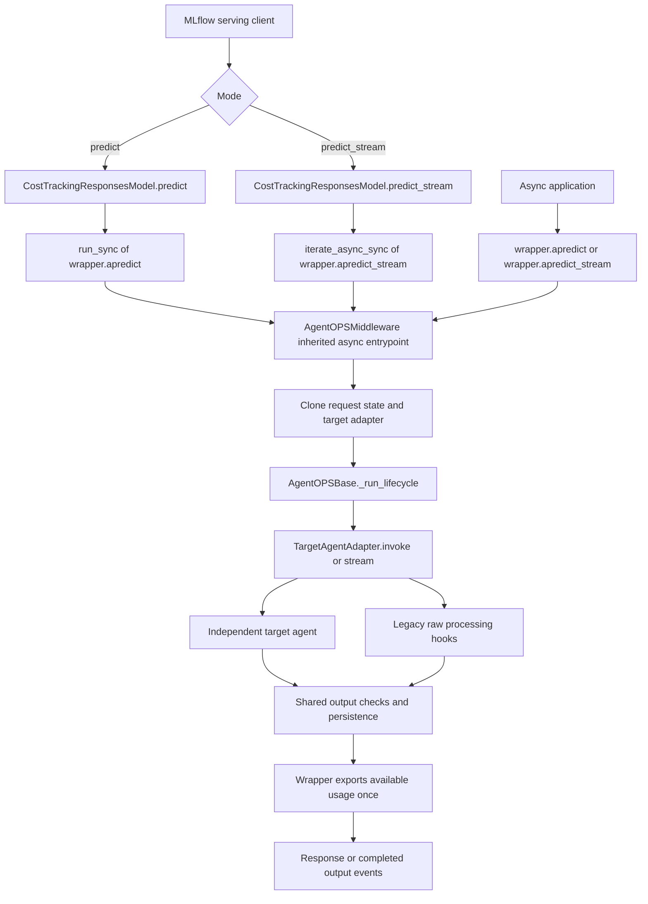
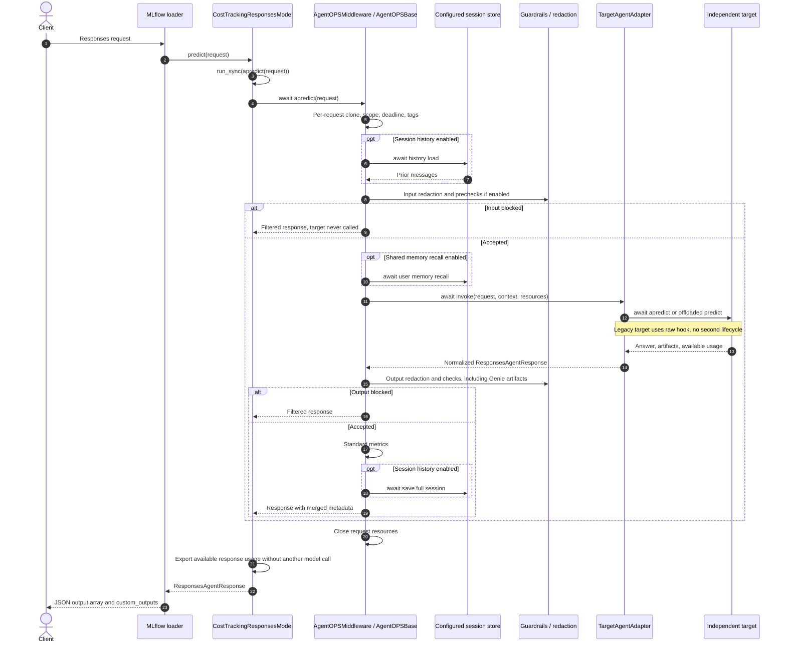
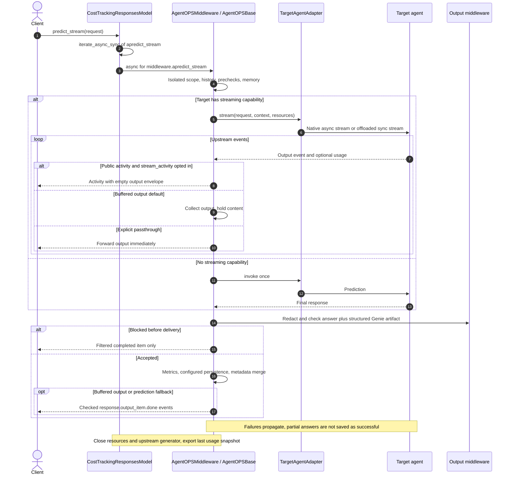
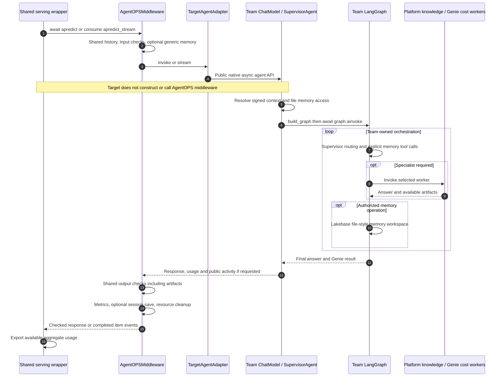

# AgentOPS request lifecycle and function dependencies

AgentOPS owns the outer request lifecycle and calls the configured target agent.
The target owns orchestration, tools and models. It does not create middleware.

## Serving contract

`MLflow loader → CostTrackingResponsesModel → AgentOPSMiddleware → TargetAgentAdapter → target`

The same lifecycle serves single agents and supervisors. `AgentOPSMiddleware`
reuses `AgentOPSBase._run_lifecycle`; it does not copy its logic. Plain
ResponsesAgents use their public APIs. PythonModels receive the normalized request
through `predict(context=None, model_input=...)`. Legacy AgentOPSBase targets use
raw processing hooks, bypassing their public lifecycle to avoid duplicate checks.

[Open the diagram viewer with zoom controls](agentops-diagrams.html).

## Reading the diagrams

`await` can use a native async integration or offload an existing blocking call.
An async caller is an application using `await wrapper.apredict(request)` or
`async for event in wrapper.apredict_stream(request)`. It is not a second agent.
MLflow serving still uses synchronous `predict` and `predict_stream`; the bridge
adapts those interfaces to the same async lifecycle without replaying inference.

## Public prediction and streaming entry points




## Request sequence




## Request flowchart


## Streaming sequence




## Supervisor integration




## Configuration and delivery

```yaml
middleware:
  timeout_seconds: 120
  streaming:
    output_mode: buffered
```

The timeout is optional and includes checks, target work and persistence. Output
is buffered by default until postchecks finish. `passthrough` explicitly opts into
immediate output delivery; later violations can be flagged but cannot retract
content. Output PII redaction forces buffering. Buffered streaming emits completed
items after checks, rather than token deltas. Targets can emit public activity
when the request opts into `custom_inputs.stream_activity: true`; this is progress
metadata, not private model reasoning. Playground requests should omit that opt-in.

History, shared memory and guards retain their existing configurations. Server
recalled memory is available to neutral targets in
`custom_inputs.agentops_context.user_memories`; supplied values under that reserved
key are removed before binding server memory. This is a context contract, not an
identity authentication mechanism. Supervisor file-style memory remains a team
capability governed by signed application context.

## Ownership and failure behavior

Each request gets isolated middleware state and a target adapter copy. Existing
clients and target fields can remain shared and must be concurrency safe. Native
async capabilities are awaited; blocking compatibility methods use workers.
Request resources close on completion, failure, timeout and cooperative cancellation.
Already-running blocking database/SDK operations cannot be rolled back by cancelling
the caller. Target exceptions propagate without automatic replay. Interrupted
streams do not persist partial answers as successful sessions.

Input rejection prevents target invocation. Buffered output rejection replaces the
answer. These early blocks currently skip the normal successful-session metrics
and persistence stage. Native model traces still account for calls already made.
Usage is exported from available snapshots, never added again simply because a
wrapper exists. Model spans remain responsible for native token/cost metrics.
Genie internal usage coverage remains partial.

## Function dependencies

The index below is generated from the implementation. Calls include conditional
and diagnostic branches, so it is a dependency reference, not an execution order.

## AgentOPSBase

Source: `src/framework/agent_base.py`.

### `__init__()`

Synchronous. Implementation line: 56.

Calls: `PIIRedactionMiddleware`, `PostLLMGuardrails`, `PreLLMGuardrails`, `SessionStore`, `agent_cfg.get`, `config.get`, `configure_trace_destination`, `gr_config.get`, `self._resolve_environment`, `tracing_config.get`.

### `_async_request_agent()`

Synchronous. Implementation line: 85.

Calls: `copy`.

### `_resolve_environment()`

Synchronous. Implementation line: 93.

Calls: `WorkspaceClient`, `host.lower`, `os.environ.get`, `tracing_config.get`, `tracing_config.get('default_tags', {}).get`.

### `_set_trace_tags()`

Synchronous. Implementation line: 129.

Calls: `mlflow.update_current_trace`, `str`, `tags.items`, `tags.update`.

### `_llm_request_body()`

Synchronous. Implementation line: 136.

Calls: `'\n\n'.join`, `body.setdefault`, `extract_request_text`, `input_items.append`, `instructions.append`, `item.get`, `request.model_dump`.

### `_responses_api_path()`

Synchronous. Implementation line: 153.

Calls: `ValueError`, `self.config.get`, `self.config.get('llm', {}).get`.

### `_call_llm()`

Synchronous. Implementation line: 160.

Calls: `ResponsesAgentResponse`, `RuntimeError`, `WorkspaceClient`, `WorkspaceClient().serving_endpoints.get_open_ai_client`, `client.post`, `item.model_dump`, `mlflow.get_current_active_span`, `mlflow.trace`, `record_response_usage`, `self._llm_request_body`, `self._responses_api_path`.

### `_call_llm_stream()`

Synchronous. Implementation line: 176.

Calls: `ResponsesAgentStreamEvent`, `RuntimeError`, `WorkspaceClient`, `WorkspaceClient().serving_endpoints.get_open_ai_client`, `client.post`, `event.model_dump`, `mlflow.get_current_active_span`, `mlflow.trace`, `record_response_usage`, `self._llm_request_body`, `self._responses_api_path`.

### `predict()`

Synchronous. Implementation line: 209.

Calls: `run_sync`, `self._apredict_turn`.

### `apredict()`

Async. Implementation line: 214.

Calls: `self._async_request_agent`, `turn._apredict_turn`.

### `_aprocess_request()`

Async. Implementation line: 218.

Calls: `run_blocking`.

### `_request_scope()`

Async. Implementation line: 223.

Calls: `AsyncExitStack`, `request_deadline`, `self.config.get`, `self.config.get('middleware', {}).get`.

### `_apredict_turn()`

Async. Implementation line: 235.

Calls: `aclosing`, `self._request_scope`, `self._run_lifecycle`.

### `_run_lifecycle()`

Async. Implementation line: 241.

Calls: `' '.join`, `(event.custom_outputs or {}).get`, `(request.custom_inputs or {}).get`, `(response.custom_outputs or {}).get`, `ResponsesAgentRequest.model_validate`, `ResponsesAgentResponse`, `ResponsesAgentStreamEvent`, `RuntimeError`, `aclosing`, `call_async_method`, `custom_inputs.get`, `custom_outputs.get`, `custom_outputs.update`, `emit_standard_trace_metrics`, `envelope.get`, `event.model_copy`, `event.model_dump`, `extract_request_text`, `extract_response_text`, `full_output.append`, `getattr`, `isinstance`, `item.model_dump`, `json.dumps`, `len`, `logger.warning`, `message.get`, `mlflow.get_current_active_span`, `mlflow.update_current_trace`, `payload.get`, `post_result.get`, `pre_result.get`, `pre_result.get('checks', {}).get`, `pre_result.get('checks', {}).get('intent', {}).get`, `request.model_dump`, `response.custom_outputs.get`, `self._aload_session_history`, `self._aprocess_request`, `self._aprocess_request_stream`, `self._arecall_long_term_memory`, `self._buffers_stream_output`, `self._build_response`, `self._session_outputs`, `self._set_trace_tags`, `self.guardrail_middleware.process_request`, `self.guardrail_middleware.process_response`, `str`, `stream_custom.update`, `time.time`, `uuid.uuid4`.

### `_load_session_history()`

Synchronous. Implementation line: 431.

Calls: `mlflow.trace`, `self._apply_session_history`, `self.session_store.get_history`.

### `_aload_session_history()`

Async. Implementation line: 442.

Calls: `getattr`, `iscoroutinefunction`, `method`, `run_blocking`, `self._apply_session_history`.

### `_apply_session_history()`

Synchronous. Implementation line: 450.

Calls: `getattr`, `len`, `list`, `mlflow.update_current_trace`, `str`, `turn.get`.

### `_recall_long_term_memory()`

Synchronous. Implementation line: 492.

Calls: `mlflow.trace`, `self._apply_recalled_memory`, `self.session_store.recall_user_memories`.

### `_arecall_long_term_memory()`

Async. Implementation line: 501.

Calls: `getattr`, `iscoroutinefunction`, `method`, `run_blocking`, `self._apply_recalled_memory`.

### `_apply_recalled_memory()`

Synchronous. Implementation line: 509.

Calls: `len`, `mlflow.update_current_trace`, `str`.

### `_session_outputs()`

Synchronous. Implementation line: 523.

No function calls.

### `_build_response()`

Synchronous. Implementation line: 526.

Calls: `ResponsesAgentResponse`, `self._session_outputs`, `self.create_text_output_item`, `str`, `uuid.uuid4`.

### `_process_request()`

Synchronous. Implementation line: 536.

Calls: `NotImplementedError`.

### `_process_request_stream()`

Synchronous. Implementation line: 542.

Calls: `NotImplementedError`.

### `_aprocess_request_stream()`

Async. Implementation line: 548.

Calls: `aclosing`, `iterate_blocking`.

### `_supports_streaming()`

Synchronous. Implementation line: 554.

Calls: `type`.

### `_buffers_stream_output()`

Synchronous. Implementation line: 560.

No function calls.

### `_astream_turn()`

Async. Implementation line: 563.

Calls: `ResponsesAgentStreamEvent`, `aclosing`, `isinstance`, `item.model_dump`, `result.usage.model_dump`, `self._request_scope`, `self._run_lifecycle`, `self._supports_streaming`.

### `apredict_stream()`

Async. Implementation line: 579.

Calls: `aclosing`, `self._async_request_agent`, `turn._astream_turn`.

### `predict_stream()`

Synchronous. Implementation line: 585.

Calls: `iterate_async_sync`, `self._astream_turn`.

## TargetAgentAdapter

Source: `src/framework/inference/agent_middleware.py`.

### `__init__()`

Synchronous. Implementation line: 39.

Calls: `isinstance`.

### `for_request()`

Synchronous. Implementation line: 44.

Calls: `copy`, `self.target._async_request_agent`, `type`, `type(self)`.

### `supports_streaming()`

Synchronous. Implementation line: 50.

Calls: `getattr`, `self.target._supports_streaming`, `type`.

### `_bind()`

Synchronous. Implementation line: 60.

Calls: `context.get`, `custom.pop`, `custom.setdefault`, `dict`, `request.model_copy`.

### `invoke()`

Async. Implementation line: 77.

Calls: `call_async_method`, `request.model_dump`, `self._bind`, `self.target._aprocess_request`, `wrap_target_result`.

### `stream()`

Async. Implementation line: 88.

Calls: `aclosing`, `getattr`, `isasyncgenfunction`, `iterate_blocking`, `native`, `self._bind`, `self.target._aprocess_request_stream`.

## AgentOPSMiddleware

Source: `src/framework/inference/agent_middleware.py`.

### `__init__()`

Synchronous. Implementation line: 108.

Calls: `TargetAgentAdapter`, `self._buffers_stream_output`, `super`, `super().__init__`.

### `_async_request_agent()`

Synchronous. Implementation line: 120.

Calls: `self.adapter.for_request`, `super`, `super()._async_request_agent`.

### `_session_outputs()`

Synchronous. Implementation line: 125.

Calls: `getattr`, `getattr(self, '_request_context', {}).get`, `mlflow.get_current_active_span`, `mlflow.get_last_active_trace_id`, `str`, `super`, `super()._session_outputs`.

### `_supports_streaming()`

Synchronous. Implementation line: 134.

No function calls.

### `_buffers_stream_output()`

Synchronous. Implementation line: 137.

Calls: `ValueError`, `self.config.get`, `self.config.get('middleware', {}).get`, `self.config.get('middleware', {}).get('streaming', {}).get`, `super`, `super()._buffers_stream_output`.

### `_aprocess_request()`

Async. Implementation line: 143.

Calls: `self.adapter.invoke`.

### `_aprocess_request_stream()`

Async. Implementation line: 146.

Calls: `aclosing`, `self.adapter.stream`.

## CostTrackingResponsesModel

Source: `src/framework/inference/cost_tracking_model.py`.

### `load_context()`

Synchronous. Implementation line: 93.

Calls: `AgentOPSMiddleware`, `_resolve_inner_model`, `getattr`, `hasattr`, `isinstance`, `self._inner.load_context`.

### `predict()`

Synchronous. Implementation line: 102.

Calls: `run_sync`, `self.apredict`.

### `apredict()`

Async. Implementation line: 106.

Calls: `_record_usage`, `self._middleware.apredict`.

### `predict_stream()`

Synchronous. Implementation line: 115.

Calls: `iterate_async_sync`, `mlflow.trace`, `self.apredict_stream`.

### `apredict_stream()`

Async. Implementation line: 121.

Calls: `_record_usage`, `aclosing`, `response_usage`, `self._middleware.apredict_stream`.
