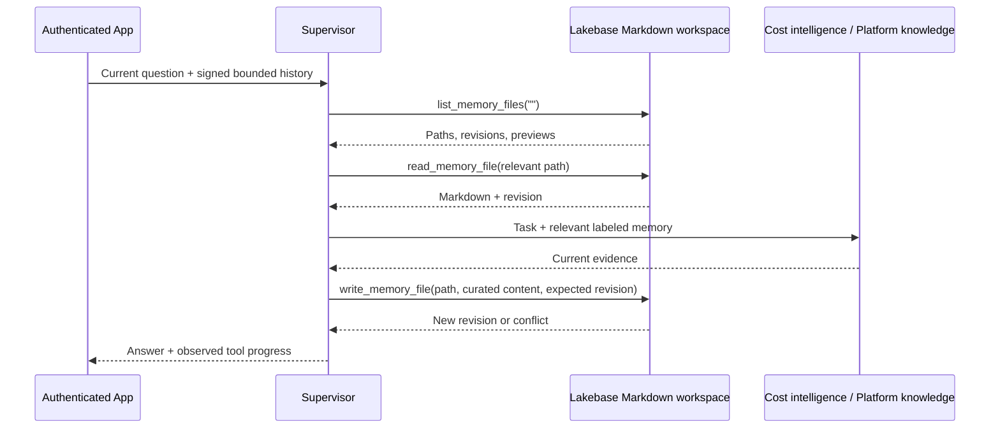

# Supervisor-managed Markdown memory

The supervisor explicitly manages a virtual file workspace. Markdown paths and
contents reside in Lakebase, rather than on the serving container's disk. This
provides durable files shared by serving replicas without adding a separate
memory agent or changing the customer's orchestration.



Tools:

| Tool | Behavior |
|---|---|
| `list_memory_files(query="")` | Mandatory first call; lists up to 40 live files with previews. Optional literal search. |
| `read_memory_file(path)` | Read content and revision before using or editing a note. |
| `write_memory_file(path, content, expected_revision)` | Create with revision 0; replace using the last observed revision. Conflicts require rereading. |
| `delete_memory_file(path, expected_revision)` | Soft-delete obsolete notes; preserves earlier versions. |
| `memory_file_history(path)` | Retrieve up to 10 prior versions; restore with an ordinary revision-checked write. |

Suggested organization:

```text
/memories/profile.md
/memories/workloads/daily-batch.md
/memories/cost-patterns/batch-estimation.md
```

Files should separate observed facts, assumptions, evidence, dates, region,
currency, proposed patterns, and unresolved questions. The supervisor can condense
or reorganize notes; it should avoid dumping chat transcripts. File names are
restricted to lowercase letters, digits, hyphens and underscores under
`/memories/`, ending in `.md`; traversal and arbitrary OS access are rejected.
Each file is capped at 12,000 characters. A rename is a create followed by a
soft-delete after confirmed success; it is not an atomic operation.

Owner identity comes from verified App context, never from model tool arguments
or a typed email address. All queries include the authenticated owner. Guardrails
screen writes for sensitive or instruction-like content. Revision history records
conversation and trace provenance plus source fingerprints, without copying raw
turns into the version metadata. These controls do not verify the factual accuracy
of model-authored Markdown. A `PROPOSED` or `validated` label is a note, not an
enforced approval mechanism. Current prices must still be checked with Cost
intelligence. Retrieved files remain evidence, never system instructions.

Files expire from normal listing/reading after the configured TTL (90 days by
default, renewed on write). Version history is retained for recovery, including
soft-deleted or expired notes; this is not a privacy-erasure operation. Retention
and permanent erasure need a separate administrative policy. Database permissions
scope access to the runtime principal; user isolation is enforced by the trusted
application/store layer, not per-user PostgreSQL identities or RLS in this version.

App conversation history is independent of curated memory. It supplies a bounded
recent transcript and historical excerpt. The supervisor decides which reusable
facts merit a file update through explicit tools. Persistent memory is context
management; model weights are unchanged. A failed write must never be reported as
saved, and stopping the response does not roll back completed memory operations.

The pinned supervisor prompt is in `configs/prompts.json`; the readable source is
`agent/fe_multi_agent/prompts.py`. Legacy structured-memory methods remain only
for compatibility; the active graph exposes file tools.
