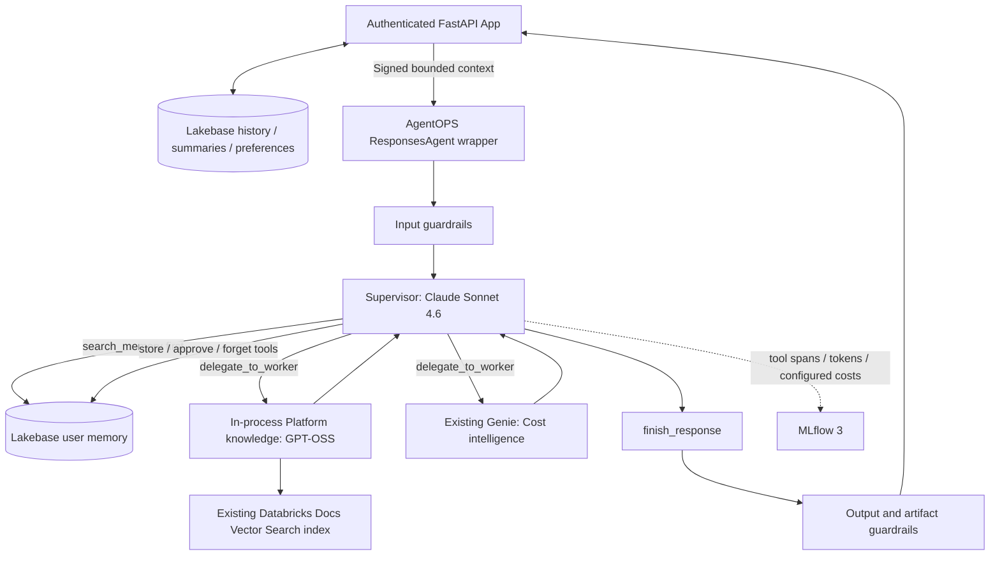

# Platform intelligence: agent-managed memory and embedded Platform knowledge

The existing supervisor ResponsesAgent is integrated through AgentOPS's standard
`agent/Agent.py` / `ChatModel` and `CostTrackingResponsesModel` contracts.
The default topology packages **supervisor + Platform knowledge in one model**.
Cost intelligence calls the existing Genie agent in STANDARD mode; no separate
custom worker serving endpoint is needed. A configurable remote ResponsesAgent
worker remains available for either specialty.

## Configuration and package

- `agent/Agent.py`: standard team entry point, request-local AgentOPS guardrails.
- `agent/fe_multi_agent/agent.py`: existing ResponsesAgent orchestration and streaming.
- `memory_graph.py`: supervisor model tool calls; search is mandatory before other tools.
- `memory.py`: scoped persistence, expiry, evidence validation and signed context verification.
- `platform_worker.py`: in-process prebuilt LangGraph agent with `retrieve_platform_docs`.
- `configs/prompts.json`: immutable, hash-verified supervisor prompt artifact.
- `config.yaml`: `platform_mode: in_process`, index/model references and memory settings.

Set `platform_mode: remote` and `platform_endpoint` to reuse a deployed knowledge
ResponsesAgent instead. For cost, set `cost_endpoint` to use an existing
ResponsesAgent endpoint; otherwise the existing `genie_space_id` is used. Worker
models are customer-owned when invoked remotely.

Default model services are `system.ai.claude-sonnet-4-6` and
`system.ai.gpt-oss-120b` through `/ai-gateway/mlflow/v1`. Existing Vector Search
index: `fevm_catalog_naren.agentops.databricks_docs_index` (`chunk_text`, `url`).
No index, Genie agent or worker endpoint is created by this implementation.

## Memory behavior

Every memory-enabled turn starts with an actual supervisor `search_memory` tool
call. The graph rejects attempts to skip it. The supervisor then chooses
`store_memory`, `approve_memory`, `forget_memory`, `delegate_to_worker` or
`finish_response`. Each specialist runs at most once per turn. The tool loop and
LangGraph recursion are bounded.

Durable memory is scoped to the authenticated App user, not the serving principal
or an email typed into chat. User facts require content and evidence quoted from
the current user message. Cost patterns require quotes from the current cost
worker's result and are stored as **pending**. Pending patterns are excluded from
retrieval until the user sends `approve pattern <memory-id>`. Deletion requires
`forget memory <memory-id>`. Facts and approved patterns expire after 90 days by
default. Store/search/approve/delete events are audited with conversation/trace
provenance. Historical prices never become authoritative current prices.

Memory tools reject instruction-like or sensitive content. The current retrieval
strategy combines text matching for approved patterns with up to eight recent
user facts, scoped by owner and expiry. Memory is user-scoped in this version;
project namespaces, semantic retrieval and a dedicated memory-management UI are
future extensions. Pattern approval is explicit, not automatic self-training.

A failed read allows execution to continue with a visible memory-unavailable
notice. Failed writes return an unsuccessful tool result. Successful memory tools
write during agent execution: cancelling a turn can leave a saved fact/proposal.
Memory writes are not contingent on successful final-answer delivery.

## Application context

Lakebase remains the source of truth for conversation history and preferences.
The browser supplies the conversation ID and current question; the App fetches
history with an authenticated owner predicate and verifies the current question
matches the latest saved turn. Browser-supplied old turns are not trusted.

The App supplies at most 12 recent turns with a 20,000-character budget, plus a
persisted extractive summary capped at 6,000 characters. The summary is a bounded
excerpt of older turns, not a claim to retain every historical detail. Only the
chart preference is included; display names/contact information are omitted.
The context is signed with a dedicated secret and bound to the exact request,
conversation, owner and five-minute expiry. The supervisor verifies it before
memory access. Retrieved context remains data, separate from system instructions.

Public plan and tool activity stream while execution runs. Final text and Genie
artifacts are released after AgentOPS post-guardrails. Stop cooperatively ends
waiting; in-flight model, retrieval or memory calls may complete.

## Approval-gated FEVM setup

Persistent setup has **not run**. Automatic approval review requires explicit
approval of these additive changes to the existing FEVM environment:

1. Create `agent_memory.items`, `agent_memory.audit` and `app_history.summaries`
   in the existing Lakebase database. No existing history is deleted.
2. Grant the existing serving identity access only to the memory tables and audit
   sequence; grant the existing App identity access to conversation summaries.
3. Create isolated secret scope `fe-agentops-context`, key `signing-key`, and grant
   the App identity READ on that scope. It contains no OAuth credentials.
4. Attach the signing-key resource to the existing App; inject the same key via a
   secret reference into serving. Preserve existing App resources and environment.
5. Package a candidate with both model services and the existing retrieval index,
   then update the existing FEVM serving endpoint/App and validate real persistence.

Review the exact SQL/grants in `examples/multi_agent_fe/scripts/fevm_memory_setup.py`
and `agent/fe_multi_agent/memory.py` before running setup. Serving environment needs
`AGENT_CONTEXT_SIGNING_KEY={{secrets/fe-agentops-context/signing-key}}`; App config
uses `valueFrom: context-signing-key`. Neither secret value belongs in config/git.

Direct memory-enabled endpoint requests require signed application context.
Use the App for user requests. Isolated paired evaluation requires
`FE_MULTI_EVALUATION_OWNER=evaluation:<run-id>` and the signing key, keeping each
before/after phase in separate memory namespaces. Configure cleanup of expired
evaluation data before recurring runs.

## AgentOPS deployment and boundaries

Use `team_name: platform-intelligence`,
`team_config: src/teams/platform-intelligence/config.yaml`, and skip index creation
because the index already exists. Existing standard registration packages Agent.py,
the package and configs; `language_model_resources` declares the index and Genie,
not a separate knowledge endpoint. Runtime permissions are still required.

The supervisor owns routing, tool calls, memory policy and delegated context.
AgentOPS supplies guardrails, evaluation, usage and tracing around this application.
Provider-reported usage covers directly observed supervisor and embedded-worker
calls. Preserve native costs and use labeled configured-rate estimates where
native pricing is missing. Genie internal usage remains unavailable. Do not add
remote aggregate usage again to joined trace spans.

Root bundle deployment still needs the existing Jenkins placeholder render and
matching job dependencies. Before AgentOPS rollout, extend the shared registration
and serving jobs to inject the signing secret securely; team config alone does
not provision it. Shared root infrastructure has not been migrated to
serverless. Historical validation is in the example's `VALIDATION.md`; it does not
establish deployment of this new memory-enabled topology.

## Latest validation

The agent/App suite passed 69 tests (one optional check skipped), including a
real disposable local PostgreSQL database; seven framework tests and nine chart
tests passed. FEVM run `280309112395701` passed real-model tool use, recall across
new graph instances with stub memory, and embedded documentation retrieval.
It did not test durable FEVM memory: persistent setup remains approval-gated.

Structured facts/patterns are the implemented memory interface at this stage.
An Anthropic-style curated Markdown workspace would expose file read/create/edit/
rename/delete tools over durable storage. A process-local stub is only a test
double and must never be described as cross-session persistent storage.
