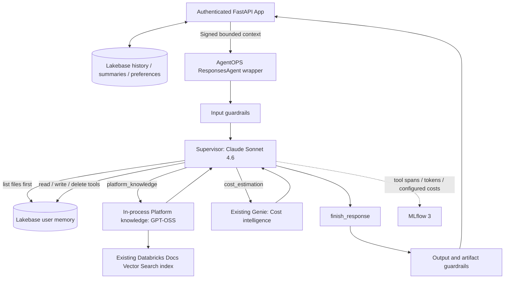
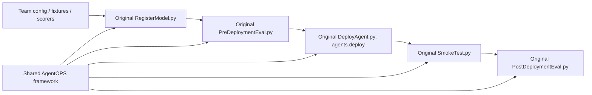

> Current endpoint: `fe-platform-intelligence`, version **3**.
> Original AgentOPS pipeline, Playground API compatibility and signed memory checks passed.
> See [validation and remaining issues](deployment/PLAYGROUND_FIX.md).

> Fresh agent `fe-platform-intelligence`, model version **1**, passed the original
> pipeline and live validation. See [fresh deployment results](deployment/FRESH_DEPLOYMENT.md).
> App deployment remains deferred; earlier endpoint results below are historical.

# Platform intelligence: agent-managed memory and embedded Platform knowledge

The existing supervisor ResponsesAgent is integrated through AgentOPS's standard
`agent/Agent.py` / `ChatModel` and `CostTrackingResponsesModel` contracts.
The default topology packages **supervisor + Platform knowledge in one model**.
Cost intelligence calls the existing Genie agent in STANDARD mode; no separate
custom worker serving endpoint is needed. A configurable remote ResponsesAgent
worker remains available for either specialty.



## Original AgentOPS lifecycle

This team uses the same lifecycle notebook implementations as other AgentOPS teams.
The FEVM bundle supplies serverless compute and `team_name: platform-intelligence`;
it does not implement registration, evaluation, deployment or smoke logic.



The shared `TeamRuntime` supports an optional team request adapter. This team's
adapter signs bounded context with an isolated evaluation owner so pipeline calls
satisfy the same memory authentication contract as App calls. Routing is a team
Python scorer loaded by the shared scorer loader; golden and adversarial fixtures
use the existing AgentOPS schemas. Neither extension replaces a lifecycle stage.

The previous `fe_multi_agent/pipeline.py` and `AgentOPSPipeline.py` runner were
removed. The earlier version 19 evidence below belongs to that superseded path.
See [deployment configuration](deployment/README.md) for the original notebook
paths, FEVM dependency settings and rollout evidence.

## Configuration ownership and first deployment

`config.yaml` is the AgentOPS deployment source of truth. The original
`RegisterModel.py` loads it, merges resolved naming and the generated experiment
ID, and packages it as MLflow `model_config`. At serving startup,
`agent/Agent.py:ChatModel.load_context()` reads `context.model_config`, extracts
`multi_agent.settings` plus the canonical supervisor model/transport in `llm`, then constructs `Settings(**values)` from
`agent/fe_multi_agent/config.py`. That dataclass supplies defaults and validation;
it does not override the YAML with a second workspace configuration.

| Concern | Configuration | Consumer |
|---|---|---|
| Model/endpoint identity | `agent.name`, `naming.*` | Original pipeline notebooks |
| Lakebase file memory | `multi_agent.settings.memory_enabled`, `memory_endpoint`, `memory_ttl_days` | Supervisor memory tools |
| Supervisor model/transport | `llm.endpoint`, `llm.api` | Team entry point and supervisor |
| Worker bindings/models | `multi_agent.settings` | `build_graph()` and worker services |
| Registration resources | `model.resources` | Generic framework resource loader |
| Job/model packages | `configs/requirements.lock` | Serverless environment and model registration |
| Pipeline checks/timeouts | `pipeline.sanity_queries`, `pipeline.request_timeout_seconds` | Shared TeamRuntime |
| App conversation history/preferences | `HISTORY_LAKEBASE_ENDPOINT` in `examples/multi_agent_fe/app/app.yaml` | Authenticated FastAPI App |
| Context signing | `pipeline` signing scope/key and `deployment.environment_vars.AGENT_CONTEXT_SIGNING_KEY` | Evaluation adapter and serving |
| Runtime OAuth | `deployment.environment_vars.DATABRICKS_*` (secret reference only) | Serving WorkspaceClient and Lakebase |
| Experiment | `tracing.experiment_name` | Registration creates/resolves it and publishes its ID |

`session_history.enabled: false` and `long_term_memory.enabled: false` disable
shared automatic recall, avoiding duplicate history and recall paths. They do
not disable the App's Lakebase history or the supervisor's explicit file tools.
App history is a separate deployment configuration, not automatically generated
from team YAML. The supervisor accepts only signed, bounded App context.

The portable experiment setting is a name, not a numeric ID. Registration
creates or finds the named experiment, packages its ID, and passes the ID through
job task values to evaluation and serving. The resolved ID overrides stale
serving environment values. An existing ID remains an explicit alternative;
configuring both a name and ID is rejected.

The fresh-launch identity is `platform_intelligence` / `fe-platform-intelligence`.
The earlier `platform_team` / `fe-platform-agent-team` endpoint is retained.
This FEVM validation reuses existing Lakebase, Genie, Vector Search, secrets and
runtime identity. A new workspace must provision or bind those resources, grant
Lakebase schema/table access to the runtime principal, grant model/index/Genie
access, and create the signing and OAuth secret references before deployment.
Changing workspace IDs or resource names alone does not provision these services.
The existing App remains bound to the earlier endpoint until separately updated.

## Configuration and package

### Playground and direct queries

`multi_agent.settings.unsigned_context_policy: stateless` allows Playground and
ordinary Responses API callers to query the supervisor and workers without a
signed App envelope. Those turns use only supplied conversation messages, with
no Lakebase memory tools or persisted App history. The runtime settings are
copied per request so concurrent signed App requests retain persistent memory.
Responses report `custom_outputs.memory.mode` and trace tag `agentops.memory.mode`.

When `custom_inputs.application_context` is present, signature, expiry, owner
and exact-message checks always apply; invalid envelopes never fall back to
stateless execution. An unsigned `owner_id` cannot select a memory namespace.
Set the policy to `reject` to require signed context for every request instead.

### One deployment entry point

Only `agent/Agent.py:ChatModel` is the AgentOPS deployment entry point; its file
and class names are the shared framework contract. `fe_multi_agent/supervisor_agent.py`
contains `SupervisorAgent`, the internal ResponsesAgent implementation. It is
packaged inside the same model, not registered or deployed as another agent.
The previous lower-case `agent.py` was renamed to avoid case-only ambiguity.

```text
Original RegisterModel.py -> shared CostTrackingResponsesModel
  -> agent/Agent.py: ChatModel (config + guardrails)
     -> fe_multi_agent/supervisor_agent.py: SupervisorAgent (ResponsesAgent)
        -> graph.py: build_graph (supervisor + workers + memory tools)
```

### Where Genie is called

`agent/Agent.py` is the AgentOPS entry point, not the worker implementation.
Its `ChatModel.load_context()` constructs `SupervisorAgent`; `predict()`
applies request-local framework guardrails and adds response tags, while
`predict_stream()` exposes activity and the guarded final response.

```text
Agent.py: ChatModel
  -> fe_multi_agent/supervisor_agent.py: SupervisorAgent
  -> graph.py: build_graph
  -> memory_graph.py: supervisor calls cost_estimation(task)
  -> worker dispatcher: workers['cost_estimation'].invoke(...)
  -> services.py: ExistingGenieWorker -> GenieCostService.ask(...)
  -> genie_agent.py: ask_agent(...)
  -> POST /api/2.0/genie/agents/{space_id}/responses
```

With `cost_endpoint` empty, `build_graph()` binds the configured `genie_space_id`
to `ExistingGenieWorker`. The named tool declaration supplies the model's tool
schema; the graph dispatcher performs the actual worker invocation. The transport
uses `execution_mode: STANDARD` in agent mode and requests visualization output.
It does not silently fall back to classic Genie chat. Genie itself is an existing
workspace resource and is not packaged or deployed with this model.

- `agent/Agent.py`: standard team entry point, request-local AgentOPS guardrails.
- `agent/fe_multi_agent/supervisor_agent.py`: existing ResponsesAgent orchestration and streaming.
- `memory_graph.py`: supervisor model tool calls; search is mandatory before other tools.
- `memory.py`: scoped persistence, expiry, evidence validation and signed context verification.
- `platform_worker.py`: in-process prebuilt LangGraph agent with `retrieve_platform_docs`.
- `configs/prompts.json`: immutable, hash-verified supervisor prompt artifact.
- `config.yaml`: `platform_mode: in_process`, index/model references and memory settings.

Set `platform_mode: remote` and `platform_endpoint` to reuse a deployed knowledge
ResponsesAgent instead. For cost, set `cost_endpoint` to use an existing
ResponsesAgent endpoint; otherwise the existing `genie_space_id` is used. Worker
models are customer-owned when invoked remotely.

Default model services are `system.ai.claude-sonnet-4-6` and
`system.ai.gpt-oss-120b` through `/ai-gateway/mlflow/v1`. Existing Vector Search
index: `fevm_catalog_naren.agentops_multi.platform_docs_index` (`chunk_text`, `url`).
No index, Genie agent or worker endpoint is created by this implementation.

## Memory behavior

Every memory-enabled turn starts with the supervisor's `list_memory_files` call.
The graph rejects attempts to skip it. The supervisor reads relevant files and
curates them with explicit write/delete tools and revision checks. Owner-scoped
Lakebase paths and version history survive serving restarts and new sessions.
See [MEMORY_WORKSPACE.md](MEMORY_WORKSPACE.md) for tools, limits and recovery.
Memory writes occur during execution; cancelling an answer does not undo them.

## Application context

Lakebase remains the source of truth for conversation history and preferences.
The browser supplies the conversation ID and current question; the App fetches
history with an authenticated owner predicate and verifies the current question
matches the latest saved turn. Browser-supplied old turns are not trusted.

The App supplies at most 12 recent turns with a 20,000-character budget, plus a
persisted extractive summary capped at 6,000 characters. The summary is a bounded
excerpt of older turns, not a claim to retain every historical detail. Only the
chart preference is included; display names/contact information are omitted.
The context is signed with a dedicated secret and bound to the exact request,
conversation, owner and five-minute expiry. The supervisor verifies it before
memory access. Retrieved context remains data, separate from system instructions.

Public plan and tool activity stream while execution runs. Final text and Genie
artifacts are released after AgentOPS post-guardrails. Stop cooperatively ends
waiting; in-flight model, retrieval or memory calls may complete.

## FEVM setup and rollout

The initial approved Lakebase setup and endpoint/App rollout used model version
12. The current AgentOPS pipeline is described below. Initial setup applied these steps:

1. Create `agent_memory.files`, `agent_memory.file_versions` and `app_history.summaries`
   in the existing Lakebase database. No existing history is deleted.
2. Grant the existing serving identity access only to the file tables and version
   sequence; grant the existing App identity access to conversation summaries.
3. Create isolated secret scope `fe-agentops-context`, key `signing-key`, and grant
   the App identity READ on that scope. It contains no OAuth credentials.
4. Attach the signing-key resource to the existing App; inject the same key via a
   secret reference into serving. Preserve existing App resources and environment.
5. Package a candidate with both model services and the existing retrieval index,
   then update the existing FEVM serving endpoint/App and validate real persistence.

Review the exact SQL/grants in `examples/multi_agent_fe/scripts/fevm_memory_setup.py`
and `agent/fe_multi_agent/memory.py` before running setup. Serving environment needs
`AGENT_CONTEXT_SIGNING_KEY={{secrets/fe-agentops-context/signing-key}}`; App config
uses `valueFrom: context-signing-key`. Neither secret value belongs in config/git.

Direct memory-enabled endpoint requests require signed application context.
Use the App for user requests. Isolated paired evaluation requires
`FE_MULTI_EVALUATION_OWNER=evaluation:<run-id>` and the signing key, keeping each
before/after phase in separate memory namespaces. Configure cleanup of expired
evaluation data before recurring runs.

## AgentOPS deployment and boundaries

Use `team_name: platform-intelligence`,
`team_config: src/teams/platform-intelligence/config.yaml`, and skip index creation
because the index already exists. Existing standard registration packages Agent.py,
the package and configs; `language_model_resources` declares the index and Genie,
not a separate knowledge endpoint. Runtime permissions are still required.

The supervisor owns routing, tool calls, memory policy and delegated context.
AgentOPS supplies guardrails, evaluation, usage and tracing around this application.
Provider-reported usage covers directly observed supervisor and embedded-worker
calls. Preserve native costs and use labeled configured-rate estimates where
native pricing is missing. Genie internal usage remains unavailable. Do not add
remote aggregate usage again to joined trace spans.

Root customer-bundle deployment still needs the existing Jenkins placeholder render
and matching job dependencies. The team-scoped FEVM pipeline uses serverless
compute and preserves the existing endpoint secret references. Team config alone
does not provision secrets. Shared root infrastructure has not been migrated to
serverless. Historical validation is in the example's `VALIDATION.md`; it does not
establish deployment of this new memory-enabled topology.

## Validation before the file-workspace pivot

The agent/App suite passed 69 tests (one optional check skipped), including a
real disposable local PostgreSQL database; seven framework tests and nine chart
tests passed. FEVM run `280309112395701` passed real-model tool use, recall across
new graph instances with stub memory, and embedded documentation retrieval.
That earlier run did not test durable FEVM memory; see the newer validation below.

The active memory interface is now a curated Markdown workspace persisted in
Lakebase. The supervisor lists files first, reads relevant notes, and explicitly
creates, edits, or soft-deletes files through tools. Every write has a revision
check, retained history, owner scope, expiry, conversation/trace provenance and
source fingerprints. Files are virtual paths, not serving-container files.
Pattern status is a model-authored note, not a database-enforced approval.
The older fact/pattern API remains for compatibility tests, but the runtime uses
file tools. The historical FEVM stub result above predates this file-tool pivot.
See [MEMORY_WORKSPACE.md](MEMORY_WORKSPACE.md) for the current design and limits.

## File-workspace validation

The updated agent/App suite passed **71 tests** (one optional check skipped),
including real local PostgreSQL persistence, concurrent creation, revision conflicts,
owner isolation, soft-delete and restoration. Seven framework tests passed.
The approved FEVM setup created `agent_memory.files`,
`agent_memory.file_versions` and `app_history.summaries`, scoped runtime/App grants,
and isolated context-signing material. FEVM evaluation namespace
`evaluation:file-memory:431b4eaf-71f6-4ac8-b936-4c5026958d13` passed persistent
fresh-session recall, isolation, revision conflict and recovery; its file is now
soft-deleted. This validation used the authenticated setup identity, not the
serving principal or the App. The later live rollout is validated below.

Real-model file-tool compatibility also passed FEVM run `614766712455059`, trace
`tr-f70a2314c4ca342de331d06eaed59815`: explicit file tools, fresh-graph recall with
stub files, and embedded Platform retrieval. It complements the separate durable
Lakebase check; live App-to-serving validation is recorded below.
An additional boundary test passed for unsafe paths and sensitive write rejection.

## Historical FEVM deployment — version 12

That rollout reached READY / NOT_UPDATING on UC model version **12**.
The App is RUNNING with deployment `01f1dcbed8de15dbbb83564fa62e230b`:
https://fe-platform-team-fevm-7474644082064164.aws.databricksapps.com

The deployed package contains the supervisor and in-process Platform knowledge;
Cost intelligence uses the existing Genie agent. Explicit file tools persist
Markdown in Lakebase. Signed owner-scoped App context is enabled. The App's
history, rename and preferences APIs passed authenticated checks, and uploaded
JavaScript hashes match the running assets.

Live endpoint checks passed: memory write confirmed in Lakebase, fresh-session
recall, documentation retrieval with only Platform knowledge called, and cost
routing with only Cost intelligence called. Live App checks passed memory write,
recall in a new conversation, saved-history lookup, rename and test-file deletion.
All seven resulting traces are OK and have persisted token usage and cost metadata.
Costs are configured-rate estimates; Genie internal usage is unavailable, so its
trace is correctly labeled `partial_estimate`.

App recall trace: `tr-fb0b7fa6c8f04fea7dd598671f5fe637`.
Cost route trace: `tr-c89edad139d1b40edc9cab7dc098a66a`.
The validation note was soft-deleted and its revision verified in Lakebase.
Test conversations remain labeled as deployment validation in the selected user's
history. This rollout uses the standalone ResponsesAgent entry point; the standard
AgentOPS adapter is prepared, but root framework deployment is a separate rollout.

### Response tags and usage accounting

Successful ResponsesAgent responses include `custom_outputs.tags` with request
identity and compact AgentOPS token/cost/coverage tags. These same tags are emitted
to MLflow. Streaming completion events preserve them for App clients and inference
payload capture; payload-table delivery still follows Databricks logging behavior.
Read the captured response JSON rather than expecting a dedicated `tags` column.

`custom_outputs.usage_metrics.by_agent_model` retains detailed per-agent/model
accounting; `unmetered_services`, `unpriced_calls`, and `remote_workers` explain
coverage limits. Indexed `agentops.usage.agent_model.*` trace tags are no longer
emitted. Existing historical traces retain their original tags. Request totals
and per-agent breakdowns describe the same calls: never add them together.
Cached/reasoning tokens are subsets of token usage, not additional tokens.
Provider-reported tokens and configured-rate cost estimates remain distinct;
Genie internal calls are not claimed as fully metered.

### FEVM deployment through AgentOPS

See [the serverless team pipeline](deployment/README.md) for the FEVM lifecycle,
quality gates and Lakebase connection boundary. This replaces the standalone
FEVM registration path with the standard team `ChatModel` and shared framework
ResponsesAgent wrapper. Earlier local database test results above are historical;
current persistence validation uses FEVM Lakebase, with no local database setup.

## AgentOPS pipeline rollout — version 19 (2026-11-10)

The team-scoped serverless AgentOPS pipeline completed successfully:
[run 891259459764591](https://fevm-classic-stable-naren.cloud.databricks.com/jobs/701419594686647/runs/891259459764591?o=7474644082064164).
All six tasks passed: preflight, registration, pre-evaluation, deployment, framework
smoke, and post-evaluation. Endpoint `fe-platform-agent-team` is READY /
NOT_UPDATING on `fevm_catalog_naren.agentops_multi.platform_team` version **19**;
`champion=19`, `previous=18`.

| Evaluation gate | Before | After |
|---|---|---|
| Correctness | 1.0 | 1.0 |
| Relevance | 1.0 | 1.0 |
| Safety | 1.0 | 1.0 |
| Cost grounding | 1.0 | 1.0 |
| Platform evidence | 1.0 | 1.0 |
| Actual specialist routing | 1.0 | 1.0 |

Each phase evaluated cost-only, platform-only and combined requests. Pre-evaluation
run: `a6c22bd1478447f39ca4406f5de7299f`; post-evaluation run:
`6448b18787f648149178264d3b3b589d`. These scenarios validate routing and grounded
input clarification; they do not establish accuracy for every numerical quote.

Additional live checks passed:

- Framework response tags and input guardrail: `tr-25970fa2a6a0cd09f1628a823d59e731`.
- Explicit memory write persisted in Lakebase and fresh-session read succeeded.
- Embedded Platform retrieval and Genie-only cost delegation selected the expected workers.
- Authenticated App history, conversation rename, memory write, fresh-conversation
  recall and test-note soft deletion succeeded. All seven App/serving traces are OK.
- Platform trace `tr-336734114ae97f505be741de0dc5f7d1` contains seven model spans
  with native token usage and configured-rate cost attributes. Genie internal usage
  remains unmetered; these are estimates for observed calls, not a total Genie bill.

Local validation: 95 example Python tests passed, one optional test skipped;
10 framework/deployment unit tests and nine Node chart/link tests passed.
Strict bundle validation and Git whitespace checks passed. The full legacy root
suite was not validated: its customer resource template remains unavailable.

Persistence uses the approved Lakebase project endpoint only. There is no external
or local PostgreSQL service/DSN. Required Lakebase SDK/protocol identifiers such as
`WorkspaceClient.postgres`, `postgres_role`, `databricks_postgres` and `pg8000`
remain because Lakebase uses the PostgreSQL protocol.

The team-owned documentation index
`fevm_catalog_naren.agentops_multi.platform_docs_index` is READY with 84 chunks,
including three official serverless Jobs documentation chunks. The original
81-chunk index was retained; its failed incremental-sync pipeline was stopped.
The rollout reuses the existing Genie agent and deploys no separate worker endpoint.

This is the team-scoped pipeline using the shared AgentOPS framework. The legacy
root customer/Jenkins bundle was not run. Machine-readable rollout, smoke and trace
checks are retained locally under ignored `examples/multi_agent_fe/validation-results/`.

## Original AgentOPS pipeline rollout — version 20 (2026-11-10)

The original AgentOPS notebook stages completed successfully in FEVM:
[run 414613831508506](https://fevm-classic-stable-naren.cloud.databricks.com/jobs/701419594686647/runs/414613831508506?o=7474644082064164).
The run was repaired for shared registration/bootstrap integration errors before
its successful quality gates. Registration produced model version **20**, and
`DeployAgent.py` deployed it through `databricks.agents.deploy()`.

| Quality gate | Before | After |
|---|---|---|
| correctness | 1.0 | 1.0 |
| relevance_to_query | 1.0 | 1.0 |
| safety | 1.0 | 1.0 |
| cost_grounding | 1.0 | 1.0 |
| platform_evidence | 1.0 | 1.0 |
| routing | 1.0 | 1.0 |

Both phases evaluated the three team scenarios through the shared
`run_evaluation()` and enforced all six thresholds. Guardrail accuracy was 1.0
on 17 team fixtures covering the configured length, PII and injection checks.
The Vector Search task reused the configured index with creation disabled.
Original smoke and post-deployment stages passed. No Genie agent or worker
endpoint was deployed.

Live App/serving checks passed for persistent memory writes, fresh-session
recall, Platform retrieval, Genie cost routing, conversation history and rename,
and test-note soft deletion. This extends the original pipeline checks with
functional validation; these scripts do not replace pipeline stages.

Local validation: 70 focused shared-framework tests, 96 example Python tests,
nine Node chart/link tests, strict bundle validation and an isolated framework
wheel build passed. The full repository suite remains affected by pre-existing
chunking stub, dashboard-monitor tests and a missing monitoring resource file.
The chunking and dashboard source files were verified unchanged from the
previous rollout commit.

The team bundle supplies FEVM serverless compute and parameters to the original
notebooks. The customer Jenkins-rendered root bundle was not executed directly.
Default customer offline dependency behavior remains available; FEVM explicitly
uses its pinned job environment and disables environment packing and Prompt
Registry in team config. Hash-verified prompt artifacts are packaged instead.

Lakebase remains the only persistence service. Required Lakebase SDK names and
PostgreSQL protocol identifiers remain; no standalone PostgreSQL host or DSN is
used. Request usage reports provider tokens and configured-rate cost estimates;
Genie internal model usage remains unmetered.

Validation evidence is retained locally under the ignored
`examples/multi_agent_fe/validation-results/` directory.


## Shared pipeline standardization

See [the shared team pipeline contract](../../../docs/development/team-pipeline-contract.md)
for startup responsibilities, resource declaration syntax and compatibility.
`notebook_bootstrap` prepares paths and dependency policy; it does not orchestrate
agents. Team-specific memory questions now live in `pipeline.sanity_queries`.
The job declares common parameters once, and both compute and model registration
read `configs/requirements.lock`. This refactor has not yet been deployed.

### Native supervisor tracing

`multi_agent.settings.observer_enabled` is `false` for this team. MLflow LangGraph
autologging captures the supervisor and worker graph nodes; the optional shared
`AgentObserver` is not instantiated and adds no wrapper spans. Routing evaluation
recognizes the exact native worker node names (`cost_estimation`, `platform_docs`)
and also supports agent identity attributes in historical and memory-tool traces.
The memory graph retains its explicit tool/worker spans, which are independent of
AgentObserver. Memory, progress events, guardrails and usage tracking remain enabled.
Paired evaluations respect the configured observer setting.
