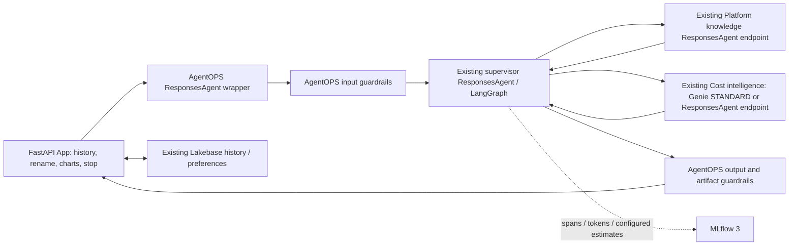

# Platform intelligence supervisor

Deploy the existing ResponsesAgent through AgentOPS as the `platform-intelligence`
team. It coordinates **Platform knowledge** and **Cost intelligence**, both existing
workers configured by reference. It does not package or deploy their implementations,
provision a Genie space, or create a Vector Search index. Case operations are removed.
Lakebase remains the separate App backend for authenticated conversation history and
preferences; no remote database resources are deleted by this change.



## Standard team layout

- `agent/Agent.py`: `ChatModel(ResponsesAgent)`, the framework's team contract.
- `agent/fe_multi_agent/`: the existing supervisor ResponsesAgent, customer-owned
  graph and adapters for existing workers. No worker implementation is packaged.
- `config.yaml`: standard AgentOPS agent/naming/deployment/guardrail/evaluation
  settings plus `multi_agent.settings` and the registered worker identities.
- `configs/prompts.json`: immutable, hash-verified supervisor prompt artifact.
- `configs/requirements.lock`: validated dependency closure for reproducibility.
- `fixtures/`: three read-only golden scenarios and adversarial requests.

`examples/multi_agent_fe/fe_multi_agent/__init__.py` bridges local example imports
to this canonical source. The FEVM snapshot uploader packages this source directly.
There is no second supervisor implementation to maintain.

## Bind the existing workers

Set `multi_agent.settings.platform_endpoint` to the existing Platform knowledge
Model Serving endpoint **name**. Its placeholder deliberately fails validation.
It must implement the MLflow ResponsesAgent input/output contract. It owns its
model choice (including GPT-OSS), retrieval, prompts and worker deployment.

For Cost intelligence use either:

- `genie_space_id`: the existing Genie agent ID; `cost_endpoint` stays empty. The
  adapter invokes agent-mode responses with `execution_mode: STANDARD` and
  `enable_viz: true`, not classic chat. Returned query evidence feeds App charts.
- `cost_endpoint`: an existing cost ResponsesAgent endpoint. It takes precedence
  over the Genie ID. For interactive charts it must preserve
  `custom_outputs.genie_result` with bounded `columns` and `rows` tables.

The supervisor model remains `system.ai.claude-sonnet-4-6` through
`/ai-gateway/mlflow/v1`. The supervisor cannot change the deployed workers' models.
Grant its serving runtime identity access to the model service and CAN_QUERY on
worker endpoints / the appropriate Genie agent permission. Resource declarations
in MLflow reference existing resources for authorization; they do not create them.
Do not put OAuth secrets in this config; retain secret references in deployment.

## AgentOPS deployment

Use the existing AgentOPS registration/evaluation/deployment pipeline with:

```yaml
team_name: platform-intelligence
team_config: src/teams/platform-intelligence/config.yaml
skip_vector_search_setup: 'yes'
```

The standard directory is **src/teams/**. In your rendered `dab-config.json` values
set `team_name`, `team_config`, and `vector_search_setup_skip: "yes"` accordingly.
Retain the selected workspace, runtime identity, catalog, experiment, serving and
Gateway settings. The supplied naming values target the existing FEVM model and
endpoint; change them before deploying into a different environment or to a new
endpoint. Keep the current deployment untouched while reviewing the new config.

`RegisterModel.py` uses the existing `CostTrackingResponsesModel` and stages the
team's `Agent.py`, `fe_multi_agent` package and sibling `configs` directory. The
framework wheel supplies AgentOPS guardrails and observability. The resource
resolver skips fake `system.ai.*` serving-endpoint resources and does not require
Vector Search for a supervisor-only team. Single-agent behavior is preserved.
Team dependency mode is `replace`, avoiding legacy LangChain pins from the shared
single-agent defaults. Install the validated dependencies on the registration job
as well as in the serving image; model requirements alone do not update job Python.

The root bundle contains Jenkins-rendered `!placeholder` values, so render through
the existing deployment workflow before `bundle validate --strict`. Its standard
pipeline currently uses job clusters. This change does not silently migrate that
shared infrastructure to serverless; FEVM contract validation uses serverless jobs.

## Runtime boundaries

The team adapter creates one AgentOPS guardrail/session context per request and
runs the existing supervisor ResponsesAgent inside it. Public plan/tool activity
streams while work runs; the final answer and Genie payload are released after
post-guardrail checks. No private model reasoning is exposed. Streaming preserves
`response.completed`, standard `usage`, execution trace IDs and custom outputs.
Cancellation stops waiting cooperatively; in-flight remote calls may finish.

Each request creates a graph. Workers receive the current user question plus a
self-contained delegated task; only their final answer returns to shared graph
state. The customer supervisor owns routing and shared context. Completed workers
cannot be called again in the same turn. Client-supplied conversation history is
retained. App history remains scoped to the authenticated user, not a typed email.
Framework-side session persistence is disabled to avoid duplicating App history.

## Evaluation and observability

Golden scenarios cover cost clarification, platform guidance and a combined
request. Existing AgentOPS built-in/domain scorers and quality gates apply to final
answers in pre/post deployment and production monitoring. The paired-evaluation
helper additionally checks observed worker routing. Production monitoring scores
captured traffic without replaying the supervisor or invoking workers.

Direct supervisor model calls supply provider-reported token counts. Native MLflow
costs are preserved; missing native costs use the explicit USD-per-million rate
card and are labeled `configured_rate_estimate`. Native per-call costs are never
written to parent spans. Example rates must be checked against applicable pricing.

Remote worker usage, if returned, appears separately in
`usage_metrics.remote_workers`, with endpoint and worker trace ID. Standard response
usage and AgentOPS cost tags describe **directly observed model calls**, not a
claimed system total. Remote usage is not added again because server spans may
already join the trace. Genie internal tokens remain unavailable. A native MLflow
header may include joined remote model spans; it can therefore differ from the
supervisor-only configured estimate.

## Gaps to close before customer deployment

| Area | Remaining validation |
|---|---|
| Worker binding | Set the real Platform knowledge endpoint; optionally set the cost endpoint. |
| Authorization | Test worker calls under the actual serving identity; declarations alone do not prove access. |
| Distributed traces | Headers are forwarded; workers must accept MLflow trace context. Otherwise follow the returned worker trace ID. |
| Context visibility | Supervisor delegated context is visible in its spans. Worker internal context/memory requires worker-owned instrumentation and access. |
| Cost completeness | Reconcile separate worker-reported usage and Gateway billing outside parent aggregates; unknown cost stays unavailable. |
| Gateway policies | Verify effective PII/rate/inference controls on the selected endpoint type; prior FEVM limitations remain. |
| Evaluation | Run all three real-worker scenarios and production monitor after binding. Mocked worker tests prove contracts, not worker answer quality. |
| Deployment pipeline | Render/validate the root bundle and install matching job dependencies. Root shared compute is not yet serverless. |

Historical FEVM validation is retained in the example's `FEVM_STATUS.md` and
`VALIDATION.md`; those records describe prior deployed versions and are not a claim
that this new external-worker team has already been deployed.

## Integration validation

Local checks: 60 agent/App tests passed (one optional database test skipped),
six framework tests passed, nine chart tests passed, and browser checks covered
history rename/reopen, composer clearing and Stop. FEVM serverless run
`52486441721419` passed the standard ResponsesAgent packaging contract with stub
workers, including pre/post guardrails and streamed progress. No workers were
provisioned or deployed. See `examples/multi_agent_fe/VALIDATION.md` for evidence
and existing root-wide validation limitations.
