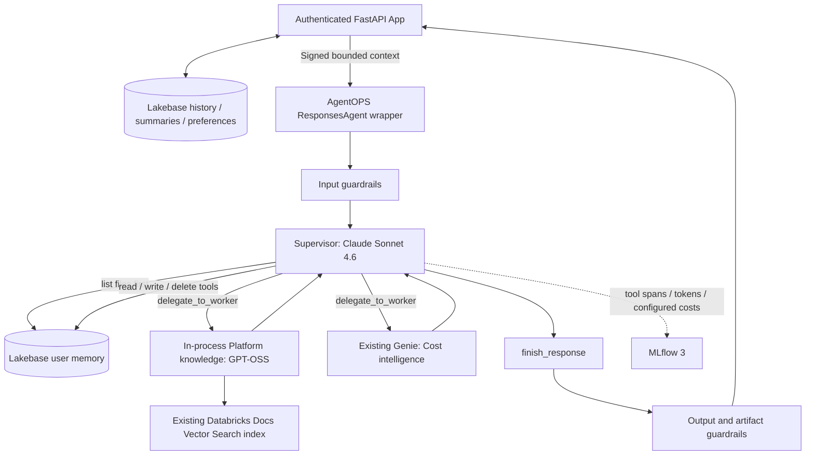

# Platform intelligence: agent-managed memory and embedded Platform knowledge

The existing supervisor ResponsesAgent is integrated through AgentOPS's standard
`agent/Agent.py` / `ChatModel` and `CostTrackingResponsesModel` contracts.
The default topology packages **supervisor + Platform knowledge in one model**.
Cost intelligence calls the existing Genie agent in STANDARD mode; no separate
custom worker serving endpoint is needed. A configurable remote ResponsesAgent
worker remains available for either specialty.

## Configuration and package

- `agent/Agent.py`: standard team entry point, request-local AgentOPS guardrails.
- `agent/fe_multi_agent/agent.py`: existing ResponsesAgent orchestration and streaming.
- `memory_graph.py`: supervisor model tool calls; search is mandatory before other tools.
- `memory.py`: scoped persistence, expiry, evidence validation and signed context verification.
- `platform_worker.py`: in-process prebuilt LangGraph agent with `retrieve_platform_docs`.
- `configs/prompts.json`: immutable, hash-verified supervisor prompt artifact.
- `config.yaml`: `platform_mode: in_process`, index/model references and memory settings.

Set `platform_mode: remote` and `platform_endpoint` to reuse a deployed knowledge
ResponsesAgent instead. For cost, set `cost_endpoint` to use an existing
ResponsesAgent endpoint; otherwise the existing `genie_space_id` is used. Worker
models are customer-owned when invoked remotely.

Default model services are `system.ai.claude-sonnet-4-6` and
`system.ai.gpt-oss-120b` through `/ai-gateway/mlflow/v1`. Existing Vector Search
index: `fevm_catalog_naren.agentops.databricks_docs_index` (`chunk_text`, `url`).
No index, Genie agent or worker endpoint is created by this implementation.

## Memory behavior

Every memory-enabled turn starts with the supervisor's `list_memory_files` call.
The graph rejects attempts to skip it. The supervisor reads relevant files and
curates them with explicit write/delete tools and revision checks. Owner-scoped
Lakebase paths and version history survive serving restarts and new sessions.
See [MEMORY_WORKSPACE.md](MEMORY_WORKSPACE.md) for tools, limits and recovery.
Memory writes occur during execution; cancelling an answer does not undo them.

## Application context

Lakebase remains the source of truth for conversation history and preferences.
The browser supplies the conversation ID and current question; the App fetches
history with an authenticated owner predicate and verifies the current question
matches the latest saved turn. Browser-supplied old turns are not trusted.

The App supplies at most 12 recent turns with a 20,000-character budget, plus a
persisted extractive summary capped at 6,000 characters. The summary is a bounded
excerpt of older turns, not a claim to retain every historical detail. Only the
chart preference is included; display names/contact information are omitted.
The context is signed with a dedicated secret and bound to the exact request,
conversation, owner and five-minute expiry. The supervisor verifies it before
memory access. Retrieved context remains data, separate from system instructions.

Public plan and tool activity stream while execution runs. Final text and Genie
artifacts are released after AgentOPS post-guardrails. Stop cooperatively ends
waiting; in-flight model, retrieval or memory calls may complete.

## FEVM setup and rollout

The approved Lakebase setup and endpoint/App rollout are complete (model version
12). The deployment applied these steps:

1. Create `agent_memory.files`, `agent_memory.file_versions` and `app_history.summaries`
   in the existing Lakebase database. No existing history is deleted.
2. Grant the existing serving identity access only to the file tables and version
   sequence; grant the existing App identity access to conversation summaries.
3. Create isolated secret scope `fe-agentops-context`, key `signing-key`, and grant
   the App identity READ on that scope. It contains no OAuth credentials.
4. Attach the signing-key resource to the existing App; inject the same key via a
   secret reference into serving. Preserve existing App resources and environment.
5. Package a candidate with both model services and the existing retrieval index,
   then update the existing FEVM serving endpoint/App and validate real persistence.

Review the exact SQL/grants in `examples/multi_agent_fe/scripts/fevm_memory_setup.py`
and `agent/fe_multi_agent/memory.py` before running setup. Serving environment needs
`AGENT_CONTEXT_SIGNING_KEY={{secrets/fe-agentops-context/signing-key}}`; App config
uses `valueFrom: context-signing-key`. Neither secret value belongs in config/git.

Direct memory-enabled endpoint requests require signed application context.
Use the App for user requests. Isolated paired evaluation requires
`FE_MULTI_EVALUATION_OWNER=evaluation:<run-id>` and the signing key, keeping each
before/after phase in separate memory namespaces. Configure cleanup of expired
evaluation data before recurring runs.

## AgentOPS deployment and boundaries

Use `team_name: platform-intelligence`,
`team_config: src/teams/platform-intelligence/config.yaml`, and skip index creation
because the index already exists. Existing standard registration packages Agent.py,
the package and configs; `language_model_resources` declares the index and Genie,
not a separate knowledge endpoint. Runtime permissions are still required.

The supervisor owns routing, tool calls, memory policy and delegated context.
AgentOPS supplies guardrails, evaluation, usage and tracing around this application.
Provider-reported usage covers directly observed supervisor and embedded-worker
calls. Preserve native costs and use labeled configured-rate estimates where
native pricing is missing. Genie internal usage remains unavailable. Do not add
remote aggregate usage again to joined trace spans.

Root bundle deployment still needs the existing Jenkins placeholder render and
matching job dependencies. Before AgentOPS rollout, extend the shared registration
and serving jobs to inject the signing secret securely; team config alone does
not provision it. Shared root infrastructure has not been migrated to
serverless. Historical validation is in the example's `VALIDATION.md`; it does not
establish deployment of this new memory-enabled topology.

## Validation before the file-workspace pivot

The agent/App suite passed 69 tests (one optional check skipped), including a
real disposable local PostgreSQL database; seven framework tests and nine chart
tests passed. FEVM run `280309112395701` passed real-model tool use, recall across
new graph instances with stub memory, and embedded documentation retrieval.
That earlier run did not test durable FEVM memory; see the newer validation below.

The active memory interface is now a curated Markdown workspace persisted in
Lakebase. The supervisor lists files first, reads relevant notes, and explicitly
creates, edits, or soft-deletes files through tools. Every write has a revision
check, retained history, owner scope, expiry, conversation/trace provenance and
source fingerprints. Files are virtual paths, not serving-container files.
Pattern status is a model-authored note, not a database-enforced approval.
The older fact/pattern API remains for compatibility tests, but the runtime uses
file tools. The historical FEVM stub result above predates this file-tool pivot.
See [MEMORY_WORKSPACE.md](MEMORY_WORKSPACE.md) for the current design and limits.

## File-workspace validation

The updated agent/App suite passed **71 tests** (one optional check skipped),
including real local PostgreSQL persistence, concurrent creation, revision conflicts,
owner isolation, soft-delete and restoration. Seven framework tests passed.
The approved FEVM setup created `agent_memory.files`,
`agent_memory.file_versions` and `app_history.summaries`, scoped runtime/App grants,
and isolated context-signing material. FEVM evaluation namespace
`evaluation:file-memory:431b4eaf-71f6-4ac8-b936-4c5026958d13` passed persistent
fresh-session recall, isolation, revision conflict and recovery; its file is now
soft-deleted. This validation used the authenticated setup identity, not the
serving principal or the App. The later live rollout is validated below.

Real-model file-tool compatibility also passed FEVM run `614766712455059`, trace
`tr-f70a2314c4ca342de331d06eaed59815`: explicit file tools, fresh-graph recall with
stub files, and embedded Platform retrieval. It complements the separate durable
Lakebase check; live App-to-serving validation is recorded below.
An additional boundary test passed for unsafe paths and sensitive write rejection.

## Live FEVM deployment — version 12

`fe-platform-agent-team` is READY / NOT_UPDATING on UC model version **12**.
The App is RUNNING with deployment `01f1dcbed8de15dbbb83564fa62e230b`:
https://fe-platform-team-fevm-7474644082064164.aws.databricksapps.com

The deployed package contains the supervisor and in-process Platform knowledge;
Cost intelligence uses the existing Genie agent. Explicit file tools persist
Markdown in Lakebase. Signed owner-scoped App context is enabled. The App's
history, rename and preferences APIs passed authenticated checks, and uploaded
JavaScript hashes match the running assets.

Live endpoint checks passed: memory write confirmed in Lakebase, fresh-session
recall, documentation retrieval with only Platform knowledge called, and cost
routing with only Cost intelligence called. Live App checks passed memory write,
recall in a new conversation, saved-history lookup, rename and test-file deletion.
All seven resulting traces are OK and have persisted token usage and cost metadata.
Costs are configured-rate estimates; Genie internal usage is unavailable, so its
trace is correctly labeled `partial_estimate`.

App recall trace: `tr-fb0b7fa6c8f04fea7dd598671f5fe637`.
Cost route trace: `tr-c89edad139d1b40edc9cab7dc098a66a`.
The validation note was soft-deleted and its revision verified in Lakebase.
Test conversations remain labeled as deployment validation in the selected user's
history. This rollout uses the standalone ResponsesAgent entry point; the standard
AgentOPS adapter is prepared, but root framework deployment is a separate rollout.
